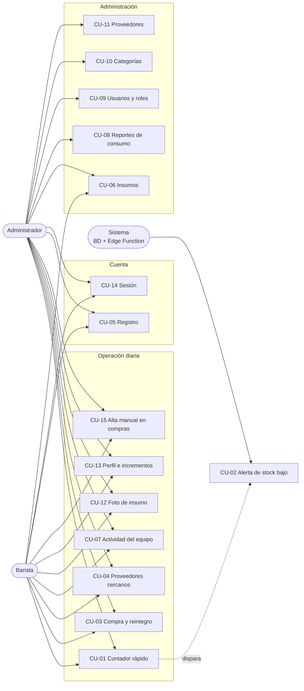
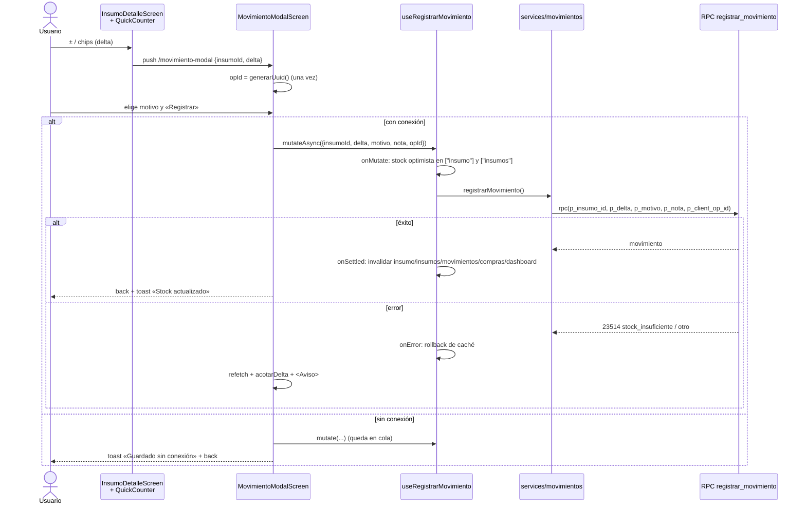
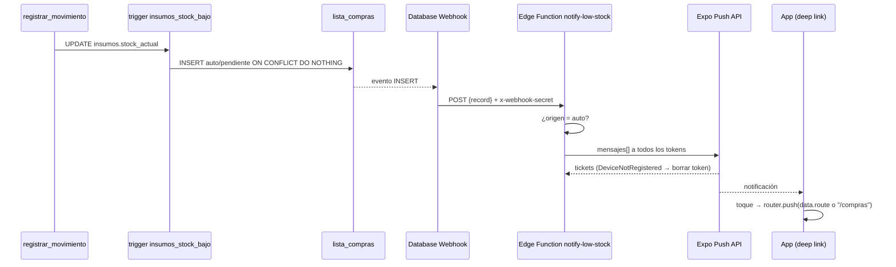

# Fase 1 · Análisis: Casos de uso principales

> **POSCafé · Specs · Fase 1 · Análisis** · Índice general: [`../../README.md`](../../README.md)
> Reconstruidos desde el flujo real del código. Los casos CU-01…CU-06 conservan el identificador histórico; CU-07…CU-14 🆕 son flujos implementados que los documentos históricos no recogían.

## 0. Mapa de actores y casos de uso

> En CU-06 el barista solo **crea y edita** (ADR-08); desactivar es exclusivo del administrador.

---

## CU-01: Contador rápido (registrar movimiento)

| Campo | Contenido |
|---|---|
| Actores | Barista, Administrador |
| Precondición | Sesión activa con perfil cargado; insumo activo |
| Flujo principal | 1) En **Inventario** abre el detalle (`/inventario/[insumoId]`). 2) Ajusta el *delta* con `−`/`+`, escribiendo en el campo, o con los **chips** (`+1`, `+5`, `+10` por defecto; tocar suma, **mantener pulsado resta**). La pantalla muestra «Quedará: X unidad». 3) Pulsa el botón fijo **«Confirmar ±N»** (deshabilitado si el delta es 0) → abre `/movimiento-modal` con `insumoId` y `delta`. 4) El modal muestra `stock → resultante` y los 5 chips de motivo, con motivo preseleccionado (`Uso en preparación` si delta < 0; `Compra recibida` si > 0); con «Otro» aparece una nota opcional. 5) Pulsa **«Registrar»**. 6) Con conexión: `useRegistrarMovimiento.mutateAsync` → RPC `registrar_movimiento` con el `opId` creado al abrir el modal; éxito → vibración háptica, `router.back()` y toast «Stock actualizado». 7) El detalle reinicia el contador a 0 (`useFocusEffect`). |
| Flujos alternos | **A) Sin red:** `onlineManager.isOnline() === false` → `registrar.mutate(...)` queda en cola, toast «Guardado sin conexión», `router.back()`; al reconectar (`resumePausedMutations`) se reenvía con el mismo `opId`. **B) `stock_insuficiente`:** el rollback restaura la caché, se hace `refetch` del insumo, `acotarDelta` recalcula y se muestra «Solo hay X disponibles. Ajustamos la cantidad…». **C) Otro error:** `<Aviso tipo="error">` con `mensajeDeError`. **D) El stock cambió en otro dispositivo (Realtime):** `QuickCounter` re-acota el delta al renderizar (RN-01). **E) `23505` con `opId`:** reintento único tras 400 ms. |
| Postcondición | Un movimiento con `saldo_resultante`; stock actualizado; posible alerta (CU-02); se invalidan `insumo`, `insumos`, `movimientos`, `compras`, `dashboard` |
| Reglas | RN-01…RN-05, RN-07, RN-14, RN-15, RN-20 |

## CU-02: Alerta de stock bajo

| Campo | Contenido |
|---|---|
| Disparador | `UPDATE OF stock_actual, stock_minimo` en `insumos` con `activo` y `stock_actual <= stock_minimo` |
| Flujo | Trigger `insumos_stock_bajo` → `private.al_cambiar_stock` inserta un ítem `origen = 'auto'`, `estado = 'pendiente'` con `cantidad_sugerida = greatest(mínimo·2 − stock, 1)` y el `proveedor_principal_id` (`ON CONFLICT (insumo_id) WHERE estado = 'pendiente' DO NOTHING`) → el `INSERT` activa el **Database Webhook** → Edge Function `notify-low-stock` (valida `x-webhook-secret`; omite si `origen ≠ 'auto'`) → consulta insumo y **todos** los `push_tokens` → Expo Push API (`channelId: "stock-alerts"`) → limpia tokens `DeviceNotRegistered` |
| Resultado | Insumo con `estado_stock` `bajo`/`agotado`; ítem pendiente visible en Compras (Realtime invalida `["compras"]`); notificación «Stock bajo: X» o «Agotado: X» con cuerpo «Quedan N unidad. Se agregó a la lista de compras.» y `data: { route: "/compras", itemId }` |
| Alterno | Ya existe pendiente → no se inserta, no hay push (RN-12). Dispositivo sin permiso/token → solo ve el ítem. Webhook no configurado → no hay push (H-06) |
| Limitación | Un insumo **creado** con stock 0 no dispara el trigger (H-02) |

## CU-03: Compra y reintegro

| Campo | Contenido |
|---|---|
| Actores | Barista, Administrador |
| Flujo principal | 1) En **Compras** marca el checkbox de un ítem (`ShoppingItem`) → `/confirmar-compra-modal?itemId=…`. 2) El modal muestra proveedor, campo de cantidad (por defecto la sugerida; admite coma o punto, hasta 3 decimales) y la proyección `stock → stock + cantidad`. 3) **«Confirmar compra»** → `comprar_item(p_item_id, p_cantidad, p_client_op_id)` con un `opId` creado al abrir el modal. 4) El ítem queda `comprado` (`cantidad_comprada`, `comprado_por`, `comprado_en`) y se genera un movimiento «Compra recibida» con nota «Compra desde lista de compras». 5) `router.back()` + toast «Compra registrada». |
| Alternos | **Compra parcial:** si el stock resultante sigue ≤ mínimo, el trigger crea un nuevo pendiente. **Ítem ya comprado por otra persona:** el modal muestra «Ya está comprado» (o «Ítem no encontrado»). **Cantidad inválida:** `<Aviso tipo="aviso">` y botón deshabilitado. **Sin red:** falla de inmediato con el mensaje de red (no se encola; ADR-10) |
| Idempotencia | Repetir `comprar_item` sobre un ítem `comprado` devuelve el ítem sin sumar (CA-06) |
| Postcondición | Se invalidan `compras`, `insumos`, `insumo`, `movimientos`, `dashboard` |

## CU-04: Proveedores cercanos (geolocalización)

| Campo | Contenido |
|---|---|
| Flujo | 1) Al abrir **Compras**, `useUbicacion` solicita el permiso «en uso» y obtiene la posición (precisión *Balanced*). 2) `useProveedoresCercanos(posicion)` llama a `proveedores_cercanos(lat, lng, radio 25 km, insumo?)`; clave de caché con la posición redondeada a 2 decimales (~1 km). 3) `SupplierMap` pinta marcadores (título = nombre; descripción = distancia o dirección); tocar el *callout* abre la ficha. 4) La lista inferior muestra **todos** los proveedores (cercanos primero; los sin coordenadas indican «Sin ubicación: no aparece en el mapa»). 5) La ficha (`/compras/proveedor/[proveedorId]`) muestra teléfono (enlace `tel:`), dirección, aviso si no tiene coordenadas y los insumos asociados con «Agregar a la lista». |
| Alternos | **Permiso denegado:** banner «Sin permiso de ubicación: no se muestran distancias»; tocar → reintenta o abre Ajustes si `canAskAgain === false`; al volver a la app (`AppState: active`) se detecta el cambio. El mapa usa todos los proveedores con coordenadas, sin distancia. **Sin coordenadas:** no aparece en el mapa (RN-13) |
| Reglas | RN-13; CA-09, CA-10 |

## CU-05: Registro

| Campo | Contenido |
|---|---|
| Flujo | Formulario (nombre, correo, contraseña; esquema `zod` con `LIMITES`) → `supabase.auth.signUp({ options: { data: { nombre } } })` **sin rol** → el trigger `al_crear_usuario` crea el perfil (primer usuario `administrador`, resto `barista`) → si el proyecto exige confirmar correo (`!data.session`), `router.replace("/login")` y diálogo «¡Cuenta creada!»; si no, la sesión se inicia sola y `(auth)/_layout` redirige a `/dashboard` |
| Alternos | Errores traducidos (`cuentaExistente`, `contrasenaDebil`, `demasiadosIntentos`, `registroCerrado`, `correoInvalido`…) en toast |
| Reglas | RN-09, RN-14, RN-19 |

## CU-06: Administración de insumos

| Campo | Contenido |
|---|---|
| Actores | Administrador y barista (crear/editar); solo administrador (desactivar) |
| Crear | Inventario → «Agregar insumo» → `/inventario/form`: nombre, unidad (`kg`/`litros`/`unidades`/`cajas`), foto opcional, categoría, proveedor principal, **stock inicial** y stock mínimo. `crearInsumo` inserta el insumo (stock 0) y, si hay stock inicial, registra un movimiento «Ajuste de inventario» / «Stock inicial». La foto se sube tras conocer el `id`; si falla, el insumo queda guardado y se avisa |
| Editar | «Editar insumo» → mismo formulario con `id`; la unidad y el stock **no son editables**; no puede guardarse hasta que el insumo cargue (evita duplicados) |
| Desactivar | Solo administrador: diálogo de confirmación → `activo = false`; el historial se conserva; el insumo desaparece del inventario (la RLS de lectura exige `activo or es_admin()`) |
| Reglas | RN-03, RN-10, RN-11, RN-14; ADR-08 |

## CU-07 🆕: Actividad del equipo

Cualquier usuario autenticado abre **Dashboard → Actividad del equipo** y ve los últimos 50 movimientos de todo el equipo («Tú agregaste 5 kg a Azúcar», «María sacó 2 litros de Leche»), con motivo, nota y tiempo relativo («ahora mismo», «hace 5 min», «ayer»). Se refresca por Realtime (`movimientos_inventario` `INSERT`) y con *pull to refresh*. Estado vacío: «Aún no hay actividad».

## CU-08 🆕: Reportes de consumo (solo administrador)

Dashboard → «Reporte de consumo» (`SoloAdmin`). Selector de rango (7 días, 30 días, este mes, 90 días; límites a medianoche local, `hasta` = mañana 00:00). `consumo_por_insumo(p_desde, p_hasta)` devuelve consumido (motivo «Uso en preparación») y merma («Merma/Vencido») por insumo, ordenado por consumo; la pantalla oculta filas sin consumo ni merma. Un barista que fuerce la ruta es redirigido a `/dashboard`; la RPC lo rechazaría con `42501`.

## CU-09 🆕: Gestión de usuarios y roles (solo administrador)

Perfil → «Gestionar usuarios y roles». Lista de perfiles con rol; botón «Hacer admin»/«Hacer barista» con diálogo de confirmación → `update perfiles set rol`. El botón está deshabilitado para el propio usuario (H-07).

## CU-10 🆕: Gestión de categorías (solo administrador)

Perfil → «Categorías»: alta (2–40 caracteres), renombrado en línea y eliminación con confirmación. Nombre duplicado → «Ya tienes una categoría con ese nombre»; categoría en uso → «No se puede eliminar: hay insumos que usan esta categoría».

## CU-11 🆕: Alta y edición de proveedores (solo administrador)

Compras → «+ Nuevo» (`/compras/proveedor/nuevo`) o «Editar proveedor». Campos: nombre (2–80), teléfono (opcional, ≥ 7 dígitos), dirección (opcional, ≤ 200) y ubicación con `SelectorUbicacion` (buscar dirección, tocar el mapa, «Usar mi ubicación», arrastrar el pin, «Quitar pin»). En la ficha, el administrador **asocia/desasocia insumos** (`proveedor_insumos`) y puede eliminar el proveedor (bloqueado si tiene insumos o compras asociados). Un barista que abra `/compras/proveedor/nuevo` es devuelto con `router.back()`.

## CU-12 🆕: Foto de insumo

Detalle → «Cambiar foto» (`/scan-modal?insumoId=…`, a pesar del nombre no escanea códigos): «Tomar foto» o «Elegir de la galería» (recorte 1:1, calidad 0.8); permisos denegados → diálogo con «Abrir Ajustes». «Guardar foto» redimensiona/comprime, sube a `fotos-insumos` y actualiza `foto_url`.

## CU-13 🆕: Perfil e incrementos rápidos

Perfil: avatar con inicial, nombre, rol y correo; editar nombre (2–60); configurar incrementos (hasta 4, separados por coma; por defecto `1, 5, 10`; «Restablecer»); accesos de administración (solo admin); «Cerrar sesión».

## CU-14 🆕: Sesión y cierre de sesión

Al iniciar, `useAuthStore.inicializar()` se suscribe a `onAuthStateChange`; con sesión carga el perfil (`obtenerPerfil`, con reintentos ante desfase de reloj). Sin perfil → `ErrorPerfil` («No pudimos cargar tu perfil», con «Reintentar» y «Cerrar sesión»). **Cerrar sesión:** `desregistrarPush()` (borra el token del dispositivo mientras aún hay sesión) → `signOut` → se limpia el estado; al detectar `SIGNED_OUT` o cambio de usuario se limpia la caché persistida (`limpiarCachePersistida`).

## CU-15 🆕: Alta manual en la lista de compras

Compras → «+ Agregar manual» (modal con buscador de insumos y cantidad, por defecto 1) o ficha del proveedor → «Agregar a la lista» (cantidad = `max(stock_mínimo, 1)`). Inserta `origen = 'manual'`, `estado = 'pendiente'`, `creado_por = auth.uid()` (lo exige la RLS `insertar_lista_manual`). Si ya hay pendiente: «Este insumo ya está en tu lista de compras».
