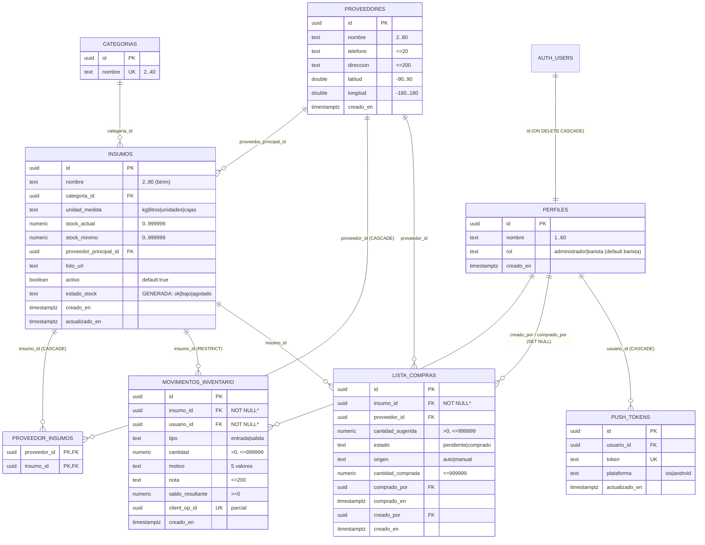

# Fase 2 · Diseño: Modelo de datos (resumen del estado final)

> **POSCafé · Specs · Fase 2 · Diseño** · Índice general: [`../../README.md`](../../README.md)
> **Fuente:** las 5 migraciones de `supabase/migrations/` aplicadas en orden (`20261001…` → `20261122…`). Este documento describe el **esquema resultante**, no cada migración.

## 1. Diagrama entidad-relación



\* `NOT NULL` se aplica en la migración 0002 **solo si** no existen filas con `NULL` (bloque `DO $$`); en una base nueva queda activo.

## 2. Resumen de tablas

| Tabla | Columnas clave | Reglas y notas |
|---|---|---|
| `perfiles` | `id` (FK `auth.users`, `ON DELETE CASCADE`), `nombre`, `rol`, `creado_en` | Alta **solo** por trigger `al_crear_usuario`; el rol lo protege `perfiles_proteger_rol`; no hay política `INSERT` específica para usuarios (solo la política `FOR ALL` del administrador, `admin_gestiona_perfiles`) |
| `categorias` | `id`, `nombre` (único) | Eliminación bloqueada por FK de `insumos` (`23503`) |
| `proveedores` | `id`, `nombre`, `telefono`, `direccion`, `latitud`, `longitud`, `creado_en` | Coordenadas opcionales; Haversine sin PostGIS |
| `insumos` | `id`, `nombre`, `categoria_id`, `unidad_medida`, `stock_actual`, `stock_minimo`, `proveedor_principal_id`, `foto_url`, `activo`, `estado_stock` (generada), `creado_en`, `actualizado_en` | El stock solo cambia por RPC (trigger); baja lógica con `activo`; `actualizado_en` lo mantiene `insumos_tocar` |
| `proveedor_insumos` | PK compuesta (`proveedor_id`, `insumo_id`) | N:M; `ON DELETE CASCADE` en ambas FK |
| `movimientos_inventario` | `insumo_id`, `usuario_id`, `tipo`, `cantidad`, `motivo`, `nota`, `saldo_resultante`, `client_op_id`, `creado_en` | **Inmutable**: sin políticas de escritura; FK a `insumos` `RESTRICT`; `cantidad` siempre positiva |
| `lista_compras` | `insumo_id`, `proveedor_id`, `cantidad_sugerida`, `estado`, `origen`, `cantidad_comprada`, `comprado_por`, `comprado_en`, `creado_por`, `creado_en` | Un solo pendiente por insumo (índice único parcial) |
| `push_tokens` | `usuario_id`, `token` (único), `plataforma`, `actualizado_en` | RLS por propietario; la Edge Function lo lee con `service_role` |

## 3. Definición consolidada (SQL del estado final)

```sql
create schema if not exists private;

create table public.perfiles (
  id        uuid primary key references auth.users(id) on delete cascade,
  nombre    text not null,
  rol       text not null default 'barista',
  creado_en timestamptz default now(),
  constraint perfiles_rol_check   check (rol in ('administrador','barista')),
  constraint perfiles_nombre_chk  check (char_length(nombre) between 1 and 60) not valid
);

create table public.categorias (
  id     uuid primary key default gen_random_uuid(),
  nombre text not null unique,
  constraint categorias_nombre_chk check (char_length(btrim(nombre)) between 2 and 40) not valid
);

create table public.proveedores (
  id        uuid primary key default gen_random_uuid(),
  nombre    text not null,
  telefono  text,
  direccion text,
  latitud   double precision,
  longitud  double precision,
  creado_en timestamptz default now(),
  constraint proveedores_texto_chk check (
    char_length(btrim(nombre)) between 2 and 80
    and (telefono  is null or char_length(telefono)  <= 20)
    and (direccion is null or char_length(direccion) <= 200)) not valid,
  constraint proveedores_coordenadas_chk check (
    (latitud  is null or latitud  between -90  and 90)
    and (longitud is null or longitud between -180 and 180)) not valid
);

create table public.insumos (
  id                     uuid primary key default gen_random_uuid(),
  nombre                 text not null,
  categoria_id           uuid references public.categorias(id),
  unidad_medida          text not null,
  stock_actual           numeric not null default 0,
  stock_minimo           numeric not null default 0,
  proveedor_principal_id uuid references public.proveedores(id),
  foto_url               text,
  creado_en              timestamptz default now(),
  actualizado_en         timestamptz default now(),
  activo                 boolean not null default true,
  estado_stock           text generated always as (
    case when stock_actual <= 0 then 'agotado'
         when stock_actual <= stock_minimo then 'bajo'
         else 'ok' end) stored,
  constraint insumos_unidad_medida_check check (unidad_medida in ('kg','litros','unidades','cajas')),
  constraint insumos_stock_chk     check (stock_actual >= 0 and stock_minimo >= 0) not valid,
  constraint insumos_nombre_chk    check (char_length(btrim(nombre)) between 2 and 80) not valid,
  constraint insumos_stock_max_chk check (stock_actual <= 999999 and stock_minimo <= 999999) not valid
);

create table public.proveedor_insumos (
  proveedor_id uuid not null references public.proveedores(id) on delete cascade,
  insumo_id    uuid not null references public.insumos(id)     on delete cascade,
  primary key (proveedor_id, insumo_id)
);

create table public.movimientos_inventario (
  id               uuid primary key default gen_random_uuid(),
  insumo_id        uuid not null references public.insumos(id) on delete restrict,
  usuario_id       uuid not null references public.perfiles(id),
  tipo             text not null,
  cantidad         numeric not null,
  motivo           text not null,
  nota             text,
  saldo_resultante numeric not null,
  client_op_id     uuid,
  creado_en        timestamptz default now(),
  constraint movimientos_inventario_tipo_check     check (tipo in ('entrada','salida')),
  constraint movimientos_inventario_cantidad_check check (cantidad > 0),
  constraint movimientos_inventario_motivo_check   check (motivo in
    ('Compra recibida','Uso en preparación','Merma/Vencido','Ajuste de inventario','Otro')),
  constraint mov_saldo_chk check (saldo_resultante >= 0) not valid,
  constraint mov_nota_chk  check (nota is null or char_length(nota) <= 200) not valid
);

create table public.lista_compras (
  id                uuid primary key default gen_random_uuid(),
  insumo_id         uuid not null references public.insumos(id),
  proveedor_id      uuid references public.proveedores(id),
  cantidad_sugerida numeric not null,
  estado            text not null default 'pendiente',
  origen            text not null default 'manual',
  cantidad_comprada numeric,
  comprado_por      uuid references public.perfiles(id) on delete set null,
  comprado_en       timestamptz,
  creado_por        uuid references public.perfiles(id) on delete set null,
  creado_en         timestamptz default now(),
  constraint lista_compras_estado_check check (estado in ('pendiente','comprado')),
  constraint lc_origen_chk              check (origen in ('auto','manual')),
  constraint lc_cantidad_chk            check (cantidad_sugerida > 0) not valid,
  constraint lc_cantidad_max_chk        check (cantidad_sugerida <= 999999
    and (cantidad_comprada is null or cantidad_comprada <= 999999)) not valid
);

create table public.push_tokens (
  id             uuid primary key default gen_random_uuid(),
  usuario_id     uuid not null references public.perfiles(id) on delete cascade,
  token          text not null unique,
  plataforma     text not null check (plataforma in ('ios','android')),
  actualizado_en timestamptz not null default now()
);
```

> Los `CHECK … NOT VALID` aplican a filas **nuevas o actualizadas**, no revalidan las existentes.

## 4. Índices

| Índice | Definición | Propósito |
|---|---|---|
| `mov_client_op_uidx` | `UNIQUE (client_op_id) WHERE client_op_id IS NOT NULL` | Idempotencia (RN-04) |
| `mov_insumo_fecha_idx` | `(insumo_id, creado_en DESC)` | Historial por insumo |
| `mov_fecha_idx` | `(creado_en DESC)` | «Actividad del equipo» y reportes |
| `insumos_categoria_idx` | `(categoria_id) WHERE activo` | Filtro de inventario |
| `insumos_nombre_idx` | `(lower(nombre))` | Orden/consulta por nombre (la búsqueda `ILIKE '%q%'` no lo aprovecha) |
| `insumos_estado_idx` | `(estado_stock) WHERE activo` | Filtro bajo/agotado y dashboard |
| `pi_insumo_idx` | `proveedor_insumos (insumo_id)` | Consulta inversa N:M |
| `lc_un_pendiente_por_insumo` | `UNIQUE (insumo_id) WHERE estado = 'pendiente'` | RN-06 |

## 5. Storage y Realtime

| Elemento | Configuración |
|---|---|
| Bucket `fotos-insumos` | `public = true`, `file_size_limit = 2097152` (2 MiB), `allowed_mime_types = {image/jpeg, image/png, image/webp}` |
| Ruta de objeto | `<insumo_id>/<timestamp>.jpg` (`services/fotos.ts`) |
| Publicación `supabase_realtime` | `insumos` (0002), `lista_compras` (0002), `movimientos_inventario` (0004) |

## 6. Valores válidos (dominio)

| Campo | Valores |
|---|---|
| `perfiles.rol` | `administrador`, `barista` |
| `insumos.unidad_medida` | `kg`, `litros`, `unidades`, `cajas` (etiquetas UI: Kg, Litros, Unidades, Cajas) |
| `insumos.estado_stock` | `ok`, `bajo`, `agotado` (generado) |
| `movimientos_inventario.tipo` | `entrada`, `salida` (deducido del signo del delta) |
| `movimientos_inventario.motivo` | `Compra recibida`, `Uso en preparación`, `Merma/Vencido`, `Ajuste de inventario`, `Otro` |
| `lista_compras.estado` | `pendiente`, `comprado` |
| `lista_compras.origen` | `auto` (trigger), `manual` (usuario) |
| `push_tokens.plataforma` | `ios`, `android` |

## 7. Datos de prueba (`supabase/seed.sql`)

Categorías `Lácteos`, `Café`, `Desechables`; proveedores *Distribuidora Centro* (31.8650, −116.6030), *Lácteos del Valle* (31.9000, −116.6100) y *Proveedor sin ubicación*; insumos *Leche entera* (20/5 litros), *Café en grano* (8/3 kg), *Azúcar* (2/4 kg → **bajo**), *Vasos 12 oz* (0/2 cajas → **agotado**); y `update insumos set stock_minimo = stock_minimo where stock_actual <= stock_minimo` para disparar los pendientes automáticos. **El seed inserta stock directo como `postgres`** (permitido por el trigger porque `auth.uid()` es nulo; ver H-03).
