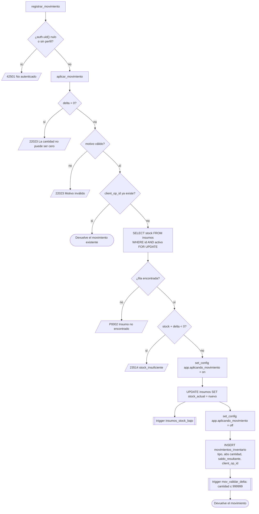
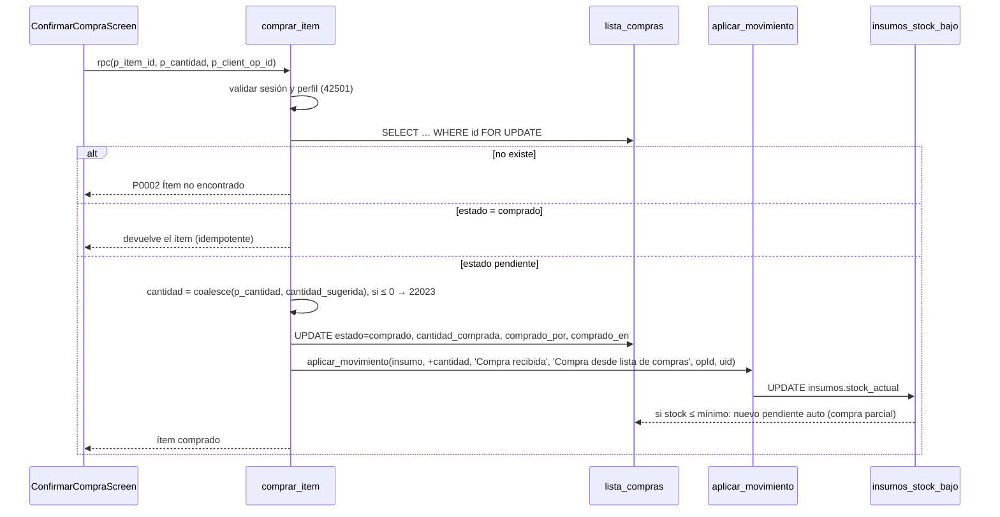
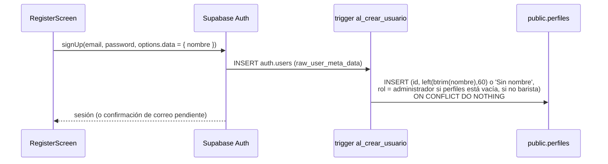

# Fase 2 · Diseño: Funciones y triggers (migración 0002 y posteriores)

> **POSCafé · Specs · Fase 2 · Diseño** · Índice general: [`../../README.md`](../../README.md)
> Nombre histórico del archivo conservado. El contenido refleja el estado final tras las migraciones 0002–0005.

## 1. Catálogo de objetos

| Objeto | Esquema / tipo | Seguridad | Propósito | Migración |
|---|---|---|---|---|
| `es_admin()` | `public` · función SQL `STABLE` | `SECURITY DEFINER`, `search_path = public` | Helper de rol para RLS y RPC (evita recursión en `perfiles`) | 0002 |
| `manejar_nuevo_usuario()` + trigger `al_crear_usuario` (`AFTER INSERT ON auth.users`) | `public` · plpgsql | `SECURITY DEFINER`; `REVOKE ALL … FROM public, anon, authenticated` | Crea el perfil: primer usuario `administrador`, resto `barista`; **ignora** el rol enviado por el cliente; recorta el nombre a 60 (0005) | 0001 → 0002 → 0005 |
| `private.proteger_rol()` + `perfiles_proteger_rol` (`BEFORE UPDATE`) | `private` · plpgsql | invoker | Impide cambiar `rol` si `auth.uid()` no es nulo y no es administrador (`42501`) | 0002 |
| `private.tocar_actualizado()` + `insumos_tocar` (`BEFORE UPDATE`) | `private` · plpgsql | invoker | Mantiene `actualizado_en` | 0002 |
| `private.proteger_stock()` + `insumos_proteger_stock` (`BEFORE UPDATE OF stock_actual`) | `private` · plpgsql | invoker | Bloquea `UPDATE` directo de `stock_actual` salvo `auth.uid()` nulo o `app.aplicando_movimiento = 'on'` (`42501`) | 0002 |
| `private.aplicar_movimiento(p_insumo_id, p_delta, p_motivo, p_nota, p_client_op_id, p_usuario)` | `private` · plpgsql → `movimientos_inventario` | `SECURITY DEFINER`, `search_path = public` | Núcleo atómico e idempotente del movimiento | 0002 |
| `registrar_movimiento(p_insumo_id, p_delta, p_motivo, p_nota default null, p_client_op_id default null)` | `public` · plpgsql → `movimientos_inventario` | `SECURITY DEFINER`; `EXECUTE` solo `authenticated` | RPC pública del contador rápido | 0002 |
| `private.al_cambiar_stock()` + `insumos_stock_bajo` (`AFTER UPDATE OF stock_actual, stock_minimo`) | `private` · plpgsql | `SECURITY DEFINER` | Inserta el ítem pendiente automático | 0002 |
| `comprar_item(p_item_id, p_cantidad default null, p_client_op_id default null)` | `public` · plpgsql → `lista_compras` | `SECURITY DEFINER`; `EXECUTE` solo `authenticated` | Cierra el ítem y reintegra stock | 0002 |
| `proveedores_cercanos(p_lat, p_lng, p_radio_km default 10, p_insumo_id default null)` | `public` · SQL `STABLE` | invoker (RLS aplica) | Haversine y orden por distancia | 0002 |
| `resumen_dashboard()` | `public` · SQL `STABLE` | invoker | `{ total, bajo, agotado }` de insumos activos | 0002 |
| `consumo_semanal(p_dias default 7, p_tz default 'America/Mexico_City')` | `public` · SQL `STABLE` | invoker | Conteo de **movimientos** de salida (uso + merma) por día | 0002 |
| `consumo_por_insumo(p_desde, p_hasta)` | `public` · plpgsql | `SECURITY DEFINER`; valida `es_admin()` (`42501`) | Consumo y merma por insumo (solo administrador) | 0002 |
| `private.validar_delta()` + `mov_validar_delta` (`BEFORE INSERT` en movimientos) | `private` · plpgsql | invoker | Rechaza `cantidad > 999999` (`22003`) | 0005 |

**Totales:** 14 funciones (8 `public` + 6 `private`) y 6 triggers de aplicación (+ `al_crear_usuario` sobre `auth.users`).

## 2. `registrar_movimiento` → `aplicar_movimiento` (contador rápido)



Puntos de diseño observables en el código:

1. **Serialización:** `FOR UPDATE` sobre la fila del insumo (solo si `activo`); un insumo desactivado produce `P0002`.
2. **Bandera transaccional:** `set_config('app.aplicando_movimiento', 'on', true)` (local a la transacción) es lo que permite al trigger `insumos_proteger_stock` dejar pasar el `UPDATE`.
3. **Idempotencia:** se consulta `client_op_id` **antes** del bloqueo (H-04). Dos peticiones simultáneas con el mismo identificador: la segunda choca con `mov_client_op_uidx` (`23505`) y se revierte; el cliente la reintenta una vez tras 400 ms y recibe el movimiento existente.
4. **Orden de efectos:** primero `UPDATE insumos` (dispara `insumos_stock_bajo`), luego `INSERT` del movimiento.
5. **`tipo` y `cantidad`:** `tipo` se deduce del signo; `cantidad` se almacena como `abs(delta)`.

## 3. Trigger de stock bajo → lista de compras

```sql
create or replace function private.al_cambiar_stock() returns trigger
language plpgsql security definer set search_path = public as $$
begin
  if new.activo and new.stock_actual <= new.stock_minimo then
    insert into public.lista_compras (insumo_id, proveedor_id, cantidad_sugerida, estado, origen)
    values (new.id, new.proveedor_principal_id,
            greatest(new.stock_minimo * 2 - new.stock_actual, 1), 'pendiente', 'auto')
    on conflict (insumo_id) where estado = 'pendiente' do nothing;
  end if;
  return new;
end $$;

create trigger insumos_stock_bajo
  after update of stock_actual, stock_minimo on public.insumos
  for each row execute function private.al_cambiar_stock();
```

| Caso | Resultado |
|---|---|
| Salida que deja `stock ≤ mínimo` | Ítem `auto/pendiente`; el webhook lo notifica |
| Segundo movimiento con pendiente existente | `DO NOTHING` (sin ítem ni push) |
| Edición de `stock_minimo` por encima del stock | **También** dispara el trigger (columna incluida en `UPDATE OF`) |
| Insumo desactivado | No genera ítem (`new.activo`) |
| `INSERT` de insumo con stock 0 y mínimo > 0 | **No** dispara el trigger (H-02) |
| Cantidad sugerida | `max(mínimo × 2 − stock, 1)`; p. ej. mínimo 5, stock 4 → 6 |

## 4. `comprar_item` (marcar comprado y reintegrar)



**Orden deliberado:** primero se cierra el ítem y después se mueve el stock, de modo que el índice único parcial permita crear un nuevo pendiente si la compra no supera el mínimo.

## 5. Alta de usuario (`manejar_nuevo_usuario`)



El `rol` **nunca** se lee de `raw_user_meta_data` (corrección de seguridad de la 0002; probada en pgTAP #1).

## 6. Funciones de lectura

| Función | Lógica | Notas |
|---|---|---|
| `proveedores_cercanos` | CTE con distancia Haversine (`6371000 · 2 · asin(√(sin²(Δφ/2) + cosφ₁·cosφ₂·sin²(Δλ/2)))`); filtra coordenadas nulas y, si `p_insumo_id` no es nulo, exige asociación en `proveedor_insumos`; devuelve `distancia_m <= p_radio_km·1000` ordenado por distancia | Radio por defecto SQL 10 km; el servicio envía 25 km (H-09) |
| `resumen_dashboard` | `count(*)`, `count(*) filter (estado_stock = 'bajo')`, `… = 'agotado'` sobre insumos `activo` | Devuelve una fila `(total, bajo, agotado)` |
| `consumo_semanal` | `generate_series` de `p_dias` días en la zona `p_tz` con `LEFT JOIN` a movimientos `tipo = 'salida'` y motivo `Uso en preparación` o `Merma/Vencido`; cuenta **movimientos**, no cantidades (las unidades difieren) | Zona por defecto fija (H-08); `dia` es `date` (H-01) |
| `consumo_por_insumo` | Suma `cantidad` por motivo (`Uso en preparación` → `consumido`; `Merma/Vencido` → `merma`) en `[p_desde, p_hasta)`; incluye todos los insumos (activos o no), ordenado por `consumido` descendente | Solo `es_admin()`; `EXECUTE` revocado a `public, anon` |

## 7. Permisos de ejecución

```sql
revoke all on function public.registrar_movimiento(uuid, numeric, text, text, uuid) from public, anon;
revoke all on function public.comprar_item(uuid, numeric, uuid)                     from public, anon;
revoke all on function public.consumo_por_insumo(timestamptz, timestamptz)           from public, anon;
grant execute on function public.registrar_movimiento(uuid, numeric, text, text, uuid) to authenticated;
grant execute on function public.comprar_item(uuid, numeric, uuid)                     to authenticated;
grant execute on function public.consumo_por_insumo(timestamptz, timestamptz)           to authenticated;
grant execute on function public.proveedores_cercanos(double precision, double precision, double precision, uuid) to authenticated;
grant execute on function public.resumen_dashboard()                                    to authenticated;
grant execute on function public.consumo_semanal(int, text)                             to authenticated;
```

> Las tres funciones de lectura invoker (`proveedores_cercanos`, `resumen_dashboard`, `consumo_semanal`) no llevan `REVOKE … FROM public, anon`; aun así dependen de tablas cuyas políticas `SELECT` son `TO authenticated`, por lo que un rol anónimo recibiría resultados vacíos.

## 8. Mejora histórica no implementada

Los documentos antiguos proponían una «migración 0003» para repetir la búsqueda de `client_op_id` *después* de `FOR UPDATE` (devolver el movimiento existente en lugar de fallar con `23505`) y un posible trigger `AFTER INSERT` para insumos nacidos bajo el mínimo. **Ninguna existe** en `supabase/migrations/`; el cliente compensa la primera (reintento único) y la segunda sigue abierta (H-02, H-04).
