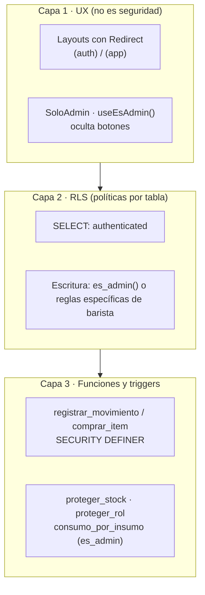

# Fase 2 · Diseño: Seguridad RLS (resumen)

> **POSCafé · Specs · Fase 2 · Diseño** · Índice general: [`../../README.md`](../../README.md)
> Estado final tras las migraciones 0002–0004. RLS está **habilitado en las 8 tablas** de `public`.

## 1. Modelo de autorización en tres capas (ADR-07)

## 2. Matriz de capacidades por rol

| Recurso | Administrador | Barista | Mecanismo |
|---|---|---|---|
| Leer insumos | Todos (incl. inactivos) | Solo `activo = true` | `lectura_insumos`: `activo or es_admin()` |
| Crear insumo | Sí (cualquier stock*) | Sí, **solo con `stock_actual = 0` y `activo = true`** | `admin_escribe_insumos` / `baristas_crean_insumos` |
| Editar insumo (nombre, mínimo, categoría, proveedor, foto…) | Sí | Sí, solo insumos activos y manteniéndolos activos | `admin_escribe_insumos` / `baristas_editan_insumos` |
| Editar `stock_actual` por `UPDATE` | **No** | **No** | Trigger `insumos_proteger_stock` (`42501`) |
| Desactivar insumo (`activo = false`) | Sí | **No** | `WITH CHECK activo = true` del barista |
| Registrar movimiento | Sí (RPC) | Sí (RPC) | `registrar_movimiento` |
| `INSERT` directo en movimientos | **No** | **No** | Sin política `INSERT` (`42501`) |
| Editar/borrar movimientos | **No** | **No** | Sin políticas `UPDATE`/`DELETE` |
| Leer movimientos | Todos | Todos | `lectura_movimientos` |
| Proveedores y `proveedor_insumos` | CRUD | Solo lectura | `admin_escribe_*` / `lectura_*` |
| Categorías | CRUD | Solo lectura | idem |
| Lista de compras: leer | Sí | Sí | `lectura_lista_compras` |
| Lista de compras: agregar manual | Sí | Sí (`origen = 'manual'`, `estado = 'pendiente'`, `creado_por = uid`) | `insertar_lista_manual` |
| Lista de compras: modificar/borrar | Sí (política `FOR ALL`) | **No** directo; sí **marcando comprado** por RPC | `admin_escribe_lista_compras`; `comprar_item` |
| Marcar comprado | Sí (RPC) | Sí (RPC) | `comprar_item` |
| Perfiles: leer | Todos | Todos (nombres para el historial) | `ver_perfiles` |
| Perfiles: editar el propio nombre | Sí | Sí | `editar_propio_perfil` |
| Perfiles: cambiar el **rol** | Sí (a cualquiera, incl. el propio: H-07) | **No** | `admin_gestiona_perfiles` + trigger `perfiles_proteger_rol` |
| `push_tokens` | Solo los propios | Solo los propios | `tokens_propios` (`usuario_id = auth.uid()`) |
| Reportes (`consumo_por_insumo`) | Sí | **No** (`42501`) | `es_admin()` dentro de la función |
| Fotos: leer | Sí | Sí | `fotos_insumos_lectura` (y bucket público) |
| Fotos: subir/reemplazar | Sí | Sí | `fotos_insumos_admin`; `fotos_insumos_baristas_subir/actualizar` |
| Fotos: borrar | Sí | **No** | Solo `fotos_insumos_admin` (`ALL` con `es_admin()`) |

\* H-03: el administrador puede insertar un insumo con stock > 0 sin generar movimiento; la app no lo hace.

## 3. Políticas (estado final)

| Tabla | Política | Comando | Rol | Condición |
|---|---|---|---|---|
| `perfiles` | `ver_perfiles` | SELECT | authenticated | `true` |
| `perfiles` | `editar_propio_perfil` | UPDATE | authenticated | `id = auth.uid()` (USING y CHECK) |
| `perfiles` | `admin_gestiona_perfiles` | ALL | authenticated | `es_admin()` |
| `categorias` | `lectura_categorias` | SELECT | authenticated | `true` |
| `categorias` | `admin_escribe_categorias` | ALL | authenticated | `es_admin()` |
| `proveedores` | `lectura_proveedores` | SELECT | authenticated | `true` |
| `proveedores` | `admin_escribe_proveedores` | ALL | authenticated | `es_admin()` |
| `insumos` | `lectura_insumos` | SELECT | authenticated | `activo or es_admin()` |
| `insumos` | `admin_escribe_insumos` | ALL | authenticated | `es_admin()` |
| `insumos` | `baristas_crean_insumos` | INSERT | authenticated | `stock_actual = 0 and activo = true and exists(perfil propio)` |
| `insumos` | `baristas_editan_insumos` | UPDATE | authenticated | USING `activo = true and exists(perfil propio)`; CHECK `activo = true` |
| `proveedor_insumos` | `lectura_proveedor_insumos` | SELECT | authenticated | `true` |
| `proveedor_insumos` | `admin_escribe_proveedor_insumos` | ALL | authenticated | `es_admin()` |
| `movimientos_inventario` | `lectura_movimientos` | SELECT | authenticated | `true` |
| `lista_compras` | `lectura_lista_compras` | SELECT | authenticated | `true` |
| `lista_compras` | `insertar_lista_manual` | INSERT | authenticated | `origen = 'manual' and estado = 'pendiente' and creado_por = auth.uid()` |
| `lista_compras` | `admin_escribe_lista_compras` | ALL | authenticated | `es_admin()` |
| `push_tokens` | `tokens_propios` | ALL | authenticated | `usuario_id = auth.uid()` |
| `storage.objects` | `fotos_insumos_lectura` | SELECT | authenticated | `bucket_id = 'fotos-insumos'` |
| `storage.objects` | `fotos_insumos_admin` | ALL | authenticated | `bucket_id = 'fotos-insumos' and es_admin()` |
| `storage.objects` | `fotos_insumos_baristas_subir` | INSERT | authenticated | `bucket_id = 'fotos-insumos'` |
| `storage.objects` | `fotos_insumos_baristas_actualizar` | UPDATE | authenticated | `bucket_id = 'fotos-insumos'` |

**Conteo:** 18 políticas en `public` (16 tras la 0002 + 2 de la 0003) y 4 en `storage.objects`. Las políticas son *permisivas*: se combinan con `OR`, por eso un barista puede editar insumos gracias a `baristas_editan_insumos` aunque `admin_escribe_insumos` no le aplique.

## 4. Protecciones por trigger y función (complementan a RLS)

| Protección | Objeto | Código de error |
|---|---|---|
| Stock no editable directamente | `insumos_proteger_stock` | `42501` «El stock solo puede modificarse registrando un movimiento» |
| Rol no autoasignable | `perfiles_proteger_rol` | `42501` «No autorizado para cambiar el rol» |
| Rol asignado por el servidor | `manejar_nuevo_usuario` | — (ignora metadata) |
| Reportes solo admin | `consumo_por_insumo` | `42501` «No autorizado» |
| Tope de cantidad | `mov_validar_delta` | `22003` |
| Funciones sensibles no expuestas | `REVOKE … FROM public, anon` | — |

> **Acceso administrativo:** los triggers permiten el cambio cuando `auth.uid()` es nulo (SQL Editor / `service_role`), lo que habilita el seed y las migraciones.

## 5. Capa de aplicación (UX; no sustituye a la BD)

| Control | Implementación | Efecto |
|---|---|---|
| Sesión | `(app)/_layout.tsx`: sin sesión → `Redirect /login` | Rutas privadas |
| Perfil no cargado | `ErrorPerfil` | Evita decidir el rol sin datos |
| Rutas solo admin | `SoloAdmin` (`/dashboard/reports`, `/perfil/usuarios`, `/perfil/categorias`) → `Redirect /dashboard` | UX |
| Proveedor nuevo | `ProveedorDetalleScreen`: efecto `router.back()` si `!esAdmin` | UX |
| Botones por rol | `useEsAdmin()` en detalle de insumo, compras, ficha de proveedor y perfil | UX |

## 6. Higiene de secretos

| Elemento | Estado |
|---|---|
| Clave pública `anon` | `EXPO_PUBLIC_SUPABASE_ANON_KEY` (esperado en un cliente; la protección real es RLS) |
| `service_role` | Solo en la Edge Function (`Deno.env`); nunca en la app |
| `WEBHOOK_SECRET` | Cabecera `x-webhook-secret` validada en la Edge Function; valor no versionado |
| `app.json` | Claves de Google Maps y `projectId` de EAS son marcadores `REEMPLAZA_…` |
| `.env` | Aparece en el árbol del repositorio; confirmar que está en `.gitignore` (contenido no incluido; H-06) |
