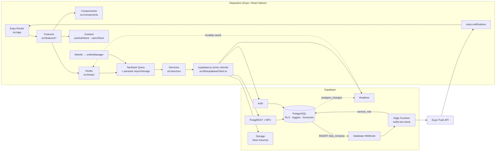
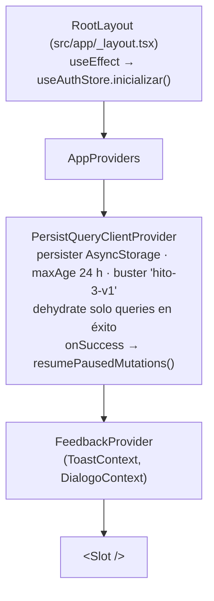
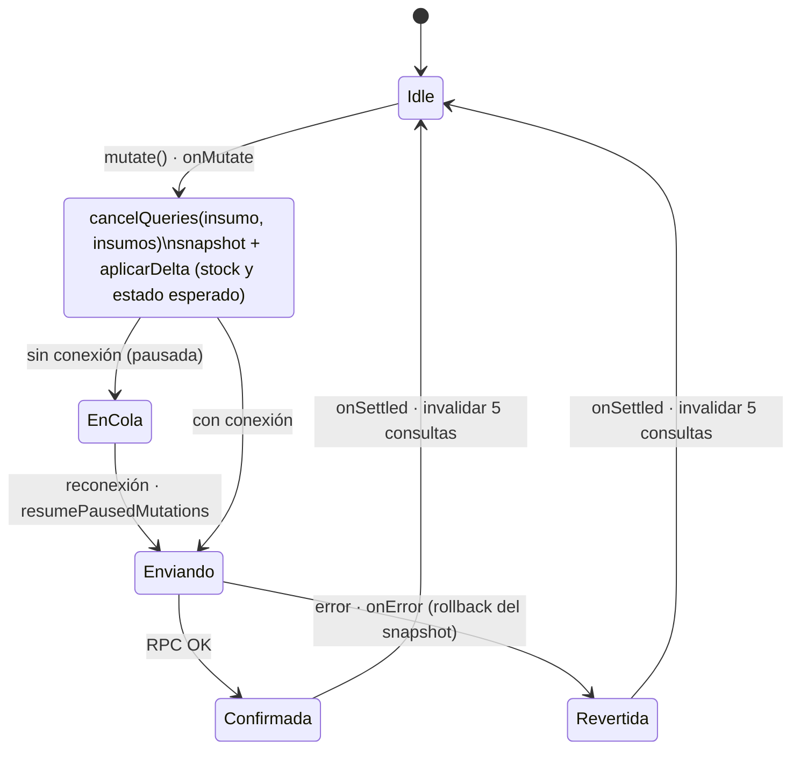

# Fase 2 · Diseño: Arquitectura frontend

> **POSCafé · Specs · Fase 2 · Diseño** · Índice general: [`../../README.md`](../../README.md)
> Fuente: `src/`, `app.json`, `package.json`, `tsconfig.json`.

## 1. Arquitectura del sistema

## 2. Capas y responsabilidades

| Capa | Ubicación | Responsabilidad | Reglas |
|---|---|---|---|
| Rutas | `src/app/**` | Declarar rutas, layouts y guardas; **archivos delgados** que re-exportan pantallas | Sin lógica de negocio |
| Pantallas | `src/features/<dominio>/*Screen.tsx` | Orquestar hooks y componentes; formularios (`react-hook-form` + `zod`) | Reciben solo `id` por parámetros (ADR-06) |
| Componentes | `src/components` | UI reutilizable sin acceso a datos | `Boton` incluye anti-doble toque |
| Hooks | `src/hooks` | `useQuery`/`useMutation` sobre servicios; efectos de plataforma (ubicación, push, realtime, red) | Definen claves de caché e invalidaciones |
| Servicios | `src/services` | Único acceso a Supabase (tablas, RPC, Storage) y a APIs del SO (geocodificación) | Traducen errores con `utils/errores` |
| Lib | `src/lib` | Infraestructura: cliente Supabase, `queryClient` + persistencia, NetInfo, notificaciones | — |
| Providers | `src/providers` | `AppProviders` (caché persistida) y `FeedbackProvider` (toasts y diálogos) | — |
| Estado cliente | `useAuthStore`, `useUiStore` | Sesión/perfil y preferencias | — |
| Utilidades | `src/utils` | Funciones puras (`acotarDelta`, `crearBloqueo`, `mensajeDeError`, `LIMITES`…) | Probables sin React |
| Tema | `src/theme/theme.ts` | Colores, espaciado, radios y tipografías (`normalizeText`) | — |
| Tipos | `src/types` | `database.types.ts` (generado) + `database.ts` (dominio) | `Insumo`, `Perfil`, `MOTIVOS`, `ItemCompra`… |

## 3. Árbol de proveedores (montaje)

## 4. Estado de servidor (TanStack Query)

### 4.1 Configuración (`src/lib/queryClient.ts`)

| Parámetro | Valor | Efecto |
|---|---|---|
| `queries.staleTime` | 60 s | Evita recargas inmediatas |
| `queries.gcTime` | 24 h (`QUERY_CACHE_MAX_AGE`) | Permite persistir y leer offline |
| `queries.networkMode` | `offlineFirst` | Sin red se sirve la caché; sin caché falla y aparece «Reintentar» |
| `queries.retry` | 1 | — |
| `mutations.networkMode` | `always` | Sin red, las mutaciones normales fallan al instante (mensaje de red) |
| Mutación `["registrar-movimiento"]` | `mutationFn` por defecto; `networkMode: "online"`; `retry: 2` | Se **pausa** sin red y se reanuda al reconectar |
| `QUERY_CACHE_BUSTER` | `"hito-3-v1"` | Cambiarlo invalida la caché persistida |
| `onlineManager` | Escucha `NetInfo`: online si `isConnected !== false && isInternetReachable !== false` | Reanuda mutaciones pausadas |
| `limpiarCachePersistida()` | `queryClient.clear()` + `queryPersister.removeClient()` | Se invoca al cerrar sesión o cambiar de usuario |

### 4.2 Alcanzabilidad de red (`src/lib/netinfo.ts`)

`NetInfo.configure` prueba `${EXPO_PUBLIC_SUPABASE_URL}/auth/v1/health` (fallback `clients3.google.com/generate_204`), considera alcanzable cualquier respuesta `< 500`, método `GET`, `useNativeReachability: false`, tiempos: corto 5 s, solicitud 15 s, largo 60 s. Evita falsos «sin conexión» por depender de Google.

### 4.3 Claves de caché y su invalidación

| Clave | Hook | Se invalida tras |
|---|---|---|
| `["insumos", filtros]` (infinita) | `useInsumos` | movimiento, compra, formulario de insumo, desactivar, Realtime `insumos` |
| `["insumo", id]` | `useInsumo` | movimiento (optimista + `onSettled`), foto, formulario, Realtime |
| `["movimientos", insumoId, limite]` | `useMovimientos` | movimiento, compra, Realtime `movimientos_inventario` |
| `["actividad", limite]` | `useActividad` | Realtime `movimientos_inventario` |
| `["compras"]`, `["compras","item",id]` | `useCompras`, `useItemCompra` | movimiento, compra, alta manual, formulario, Realtime `lista_compras` |
| `["dashboard","resumen"]`, `["dashboard","consumo"]` | `useDashboard` | movimiento, compra, formulario, desactivar, Realtime `insumos`; `refetchInterval` 60 s; `useFocusEffect` |
| `["dashboard","reporte",desde,hasta]` | `DashboardReportsScreen` | cualquier `["dashboard"]` |
| `["categorias"]` | `useCategorias` (staleTime 5 min) | `useGestionCategorias` |
| `["proveedores"]`, `["proveedor",id]`, `["proveedor",id,"insumos"]` | `useProveedores`, `useProveedor`, `useInsumosDeProveedor` | `useGestionProveedores` (también invalida `["proveedores-cercanos"]`) |
| `["proveedores-cercanos", lat≈, lng≈, insumoId]` | `useProveedoresCercanos` | `useGestionProveedores` |
| `["perfiles"]` | `usePerfiles` | `useGestionUsuarios` |
| `["insumos-todos"]` | consultas locales (modal manual, ficha de proveedor) | — (expira por `staleTime`) |

### 4.4 Actualización optimista del contador (`useRegistrarMovimiento`)

El estado optimista es solo visual (`estadoEsperado`); la BD es la autoridad (ADR-09).

## 5. Estado de cliente (Zustand)

### `useAuthStore` (`src/features/auth/authStore.ts`)

| Campo / acción | Descripción |
|---|---|
| `session`, `perfil`, `cargando` (inicia en `true`) | Estado de autenticación |
| `inicializar()` | Idempotente (variable de módulo `authSubscription`); suscribe `onAuthStateChange`; limpia caché en `SIGNED_OUT` o cambio de usuario; carga el perfil con `setTimeout(…, 0)` (evita `await` dentro del callback de Auth) |
| `cargarPerfil(userId)` | `obtenerPerfil`; si hay error: `perfil = null`, `cargando = false` |
| `iniciarSesion(correo, contrasena)` | → `{ error: string \| null }` |
| `registrarse(correo, contrasena, nombre)` | → `{ error, confirmarCorreo }`; **sin rol** |
| `cerrarSesion()` | `desregistrarPush()` → `signOut`; si falla, no limpia el estado |
| `useEsAdmin()` | `perfil?.rol === "administrador"` |

### `useUiStore` (`src/store/uiStore.ts`)

`incrementos: number[]` (por defecto `INCREMENTOS_POR_DEFECTO = [1, 5, 10]`), `setIncrementos(valores)` (normaliza: finitos, `> 0`, `≤ 999 999`, 3 decimales, únicos, **máx. 4**; si queda vacío vuelve al valor por defecto) y `restablecerIncrementos()`. Persistido con `zustand/middleware` (`persist`, clave `poscafe-ui`, `AsyncStorage`).

## 6. Sistema de feedback (`FeedbackProvider`)

| API | Firma | Comportamiento |
|---|---|---|
| `useToast()` | `exito/error/info/aviso(titulo, detalle?)`, `cerrar()` | Un solo toast; vibración háptica (éxito/error/aviso); anuncio de accesibilidad; autocierre por tipo (2.6/3.2/4.2/5.2 s); tocar lo cierra |
| `useDialogo().confirmar` | `({ titulo, mensaje?, textoConfirmar?, textoCancelar?, peligro? }) → Promise<boolean>` | Un solo diálogo a la vez (el anterior se resuelve `false`); `peligro` muestra icono de papelera y botón rojo |
| `useDialogo().informar` | `({ titulo, mensaje?, tipo?, textoCerrar?, accion? }) → Promise<void>` | Botón «Entendido»; `accion` añade un botón adicional (p. ej. «Abrir Ajustes») |
| Hooks fuera del proveedor | — | Lanzan `"useToast debe usarse dentro de <FeedbackProvider>."` (probado) |

Componentes asociados: `Aviso` (aviso en línea, `accessibilityRole="alert"`), `feedback/tipos.ts` (`TipoAviso`: `exito`/`error`/`info`/`aviso` y `ESTILOS_AVISO`).

## 7. Catálogo de componentes

| Componente | Props principales | Notas |
|---|---|---|
| `Boton` | `titulo`, `onPress`, `variante` (`primario`/`secundario`/`peligro`), `cargando`, `disabled` | `minHeight 50`; usa `crearBloqueo` (anti-doble toque) |
| `QuickCounter` | `stockActual`, `unidad`, `incrementos`, `onChangeDelta`, `disabled` | Detalle en [`03-desarrollo/diseno/01-…`](../../03-desarrollo/diseno/01-quickcounter-stepper-chips.md) |
| `ReasonChips` | `value`, `onChange`, `disabled` | `radiogroup`/`radio`; 5 motivos |
| `StockBadge` | `estado` (`ok`/`bajo`/`agotado`) | Etiquetas `OK`, `STOCK BAJO`, `AGOTADO` |
| `InsumoCard` | `insumo`, `onPress(id)` | `React.memo` (RDV-04); inicial como avatar si no hay foto |
| `ShoppingItem` | `item`, `onMarcar(itemId)`, `onAbrirProveedor?` | `React.memo`; checkbox accesible; insignia `AUTO`/`MANUAL` |
| `SupplierMap` | `proveedores`, `posicion`, `onSeleccionar` | `react-native-maps`; calcula región (mín. 0.02° de delta); defecto México |
| `SelectorUbicacion` | `direccion`, `onDireccionChange`, `valor`, `onChange`, `onInteraccion?` | Pin arrastrable, búsqueda, «Usar mi ubicación» |
| `Encabezado` + `opcionesStackConEncabezado` | `NativeStackHeaderProps` | Encabezado JS propio (alto 52 + inset superior) para igualar iOS/Android (H-15) |
| `SoloAdmin` | `children` | `Redirect /dashboard` si no es administrador |
| `PantallaCarga`, `EmptyState`, `ErrorState`, `ErrorPerfil`, `Aviso` | — | Estados de carga/vacío/error (RDV-06) |

## 8. Tema (`src/theme/theme.ts`)

Colores: `primary #2ED573`, `primaryDark #22B55E`, `primaryLight #E8FAEF`, `secondary #4A3728`, `background #F8F9FA`, `surface #FFFFFF`, `textPrimary #1E272C`, `textSecondary #636E72`, `textMuted #B2BEC3`, `border #DFE4EA`, `error #D63031`, `errorLight #FFECEC`, `warning #E17055`, `warningLight #FFEAA7`, `info #0984E3`, `infoLight #E3F2FD`, `warningDark #9A5B00`, `disabled #CED6E0`, `white`. Espaciado `xs 4 · sm 8 · md 16 · lg 24 · xl 32 · xxl 48`; radios `sm 6 · md 10 · lg 16 · pill 999`; tipografía `xs 12 … xxl 32` escalada por `normalizeText` (ancho de pantalla / 375). `userInterfaceStyle: "light"`.

## 9. Dependencias relevantes

`expo ^58.0.26` · `expo-router ~58.0.32` · `react 19.3.0` · `react-native 0.88.1` · `@supabase/supabase-js ^2.118.0` · `@tanstack/react-query ^5.104.5` (+ `persist-client`, `async-storage-persister`) · `zustand ^5.0.16` · `react-hook-form ^7.91.0` + `@hookform/resolvers ^6.0.0` + `zod ^4.6.7` · `react-native-maps 1.29.11` · `react-native-gifted-charts ^1.4.81` · `expo-notifications`, `expo-location`, `expo-image-picker`, `expo-image-manipulator`, `expo-haptics`, `expo-device`, `expo-constants` · `@react-native-community/netinfo 12.0.1` · `@react-native-async-storage/async-storage 2.2.0` · `react-native-url-polyfill` · `@react-navigation/native-stack` (residual, H-17).
