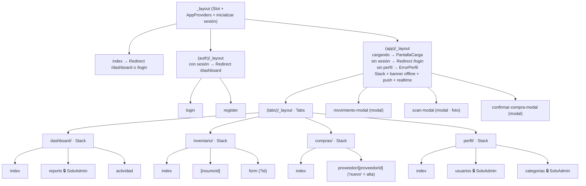
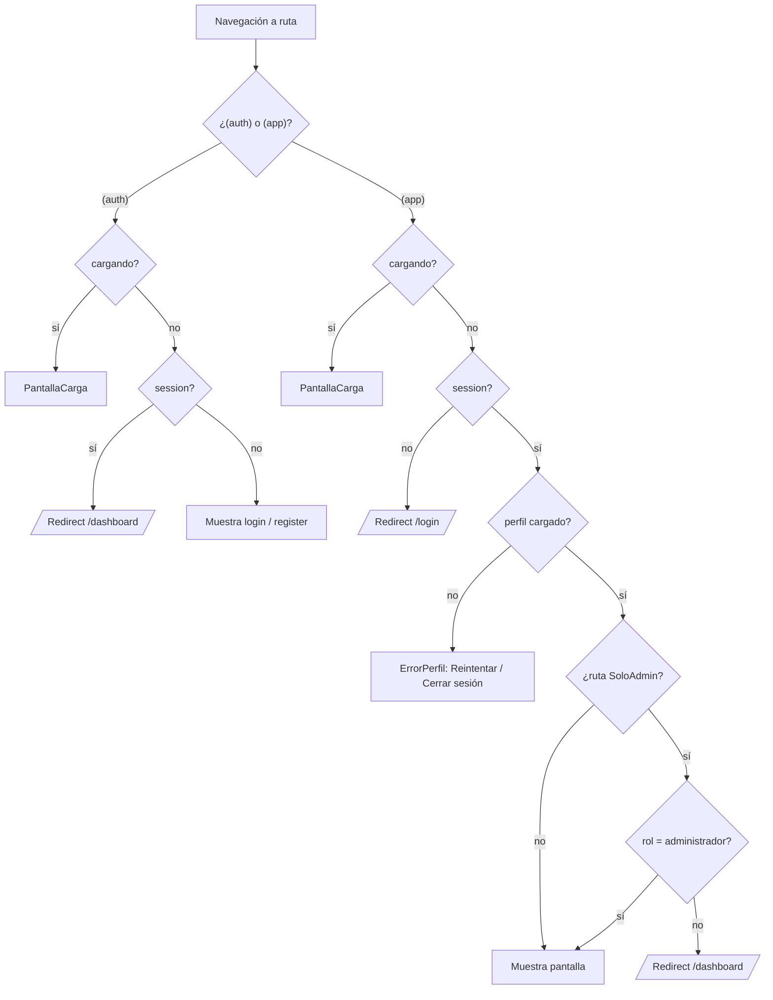

# Fase 2 · Diseño: Navegación con Expo Router y guardas por rol

> **POSCafé · Specs · Fase 2 · Diseño** · Índice general: [`../../README.md`](../../README.md)
> Esquema de deep link: `poscafe`. `typedRoutes` activo (tipos en `.expo/types/router`). Los archivos de ruta son delgados: re-exportan pantallas de `src/features`.

## 1. Árbol de navegación

## 2. Tabla de rutas

| URL | Archivo (bajo `src/app`) | Pantalla | Parámetros | Acceso |
|---|---|---|---|---|
| `/` | `index.tsx` | Redirección según sesión | — | Todos |
| `/login` | `(auth)/login.tsx` | `LoginScreen` | — | Sin sesión |
| `/register` | `(auth)/register.tsx` | `RegisterScreen` | — | Sin sesión |
| `/dashboard` | `(app)/(tabs)/dashboard/index.tsx` | `DashboardScreen` | — | Autenticado |
| `/dashboard/reports` | `…/dashboard/reports.tsx` | `DashboardReportsScreen` | — | **Administrador** |
| `/dashboard/actividad` | `…/dashboard/actividad.tsx` | `ActividadScreen` | — | Autenticado |
| `/inventario` | `…/inventario/index.tsx` | `InventarioListScreen` | — | Autenticado |
| `/inventario/[insumoId]` | `…/inventario/[insumoId].tsx` | `InsumoDetalleScreen` | `insumoId` | Autenticado |
| `/inventario/form` | `…/inventario/form.tsx` | `InsumoFormScreen` | `id?` (edición) | Autenticado (acciones por rol) |
| `/compras` | `…/compras/index.tsx` | `ListaComprasScreen` | — | Autenticado |
| `/compras/proveedor/[proveedorId]` | `…/compras/proveedor/[proveedorId].tsx` | `ProveedorDetalleScreen` | `proveedorId` o `nuevo` | Lectura: todos; alta/edición: administrador |
| `/perfil` | `…/perfil/index.tsx` | `PerfilScreen` | — | Autenticado |
| `/perfil/usuarios` | `…/perfil/usuarios.tsx` | `UsuariosScreen` | — | **Administrador** |
| `/perfil/categorias` | `…/perfil/categorias.tsx` | `CategoriasScreen` | — | **Administrador** |
| `/movimiento-modal` | `(app)/movimiento-modal.tsx` | `MovimientoModalScreen` | `insumoId`, `delta?` | Autenticado |
| `/scan-modal` | `(app)/scan-modal.tsx` | `FotoInsumoScreen` | `insumoId` | Autenticado |
| `/confirmar-compra-modal` | `(app)/confirmar-compra-modal.tsx` | `ConfirmarCompraScreen` | `itemId` | Autenticado |

> **Nota de nomenclatura:** `scan-modal` conserva el nombre histórico del plan original (escaneo), pero su pantalla es `FotoInsumoScreen` (tomar o elegir la foto del insumo y subirla a `fotos-insumos`). No hay escáner de códigos.

## 3. Guardas

| Guarda | Ubicación | Comportamiento |
|---|---|---|
| Raíz | `index.tsx` | `cargando` → `PantallaCarga`; si no, `Redirect` a `/dashboard` o `/login` |
| Autenticación pública | `(auth)/_layout.tsx` | Con sesión redirige a `/dashboard` |
| Autenticación privada | `(app)/_layout.tsx` | Sin sesión `/login`; sin perfil `ErrorPerfil` |
| Rol | `components/SoloAdmin.tsx` | Envuelve en la ruta (no en la pantalla) para `reports`, `usuarios`, `categorias` |
| Alta de proveedor | `ProveedorDetalleScreen` | Si `proveedorId === "nuevo"` y no es administrador, `router.back()` |

**Limitación:** las guardas no impiden ver datos por sí solas; la protección real es RLS (ver [seguridad](03-seguridad-rls-resumen.md)). Un deep link a una ruta restringida llega a `SoloAdmin` y se redirige.

## 4. Navegadores y presentación

| Navegador | Configuración |
|---|---|
| Raíz | `<Slot />` |
| `(app)` | `Stack` con `headerShown: false`; los tres modales con `presentation: "modal"` |
| `(tabs)` | `Tabs` (`headerShown: false`; verde `primaryDark` activo / `textMuted` inactivo); pestañas declaradas explícitamente: `dashboard`, `inventario`, `compras`, `perfil` |
| Stacks por pestaña | `opcionesStackConEncabezado` (encabezado JS `Encabezado`) |
| Banner offline | Superpuesto sobre la barra de pestañas (`bottom = inset + 49/56 + 8`); `pointerEvents="none"`, `accessibilityRole="alert"`; texto «Sin conexión · tus cambios se enviarán al reconectar» |

## 5. Flujos de navegación clave

| Flujo | Secuencia |
|---|---|
| Movimiento rápido | Inventario → `/inventario/[insumoId]` → `router.push({ pathname: "/movimiento-modal", params: { insumoId, delta } })` → confirmar → `router.back()` |
| Compra | `/compras` → `/confirmar-compra-modal?itemId` → confirmar → cierra modal |
| Foto | Detalle → `/scan-modal?insumoId` → subida → vuelve |
| Alta de proveedor | `/compras` → `/compras/proveedor/nuevo` |
| Push | Toque en notificación → `router.push(data.route)` si empieza por `/`, si no `/compras` |
| Cierre de sesión | `cerrarSesion()` → `session = null` → `(app)` redirige a `/login` |

## 6. Pruebas relacionadas

No existen pruebas automatizadas de rutas ni de guardas en `__tests__/` ni `tests/`: los layouts `(app)`/`(auth)`, `index` y `SoloAdmin` **no tienen cobertura** (`__tests__/Encabezado.test.tsx` cubre solo el encabezado). Ver [pruebas de rutas y guardas](../../04-pruebas/diseno/03-pruebas-de-rutas-y-guardas-expo-router.md), que propone los casos pendientes.
