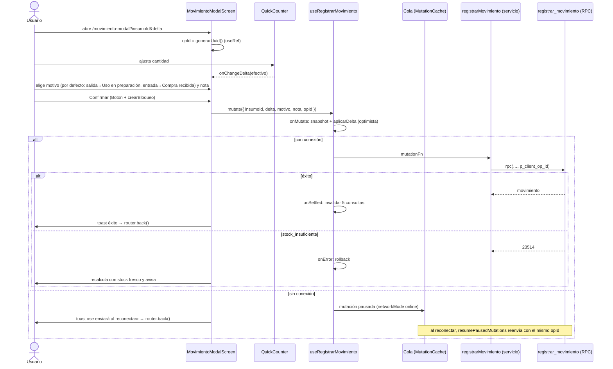

# Fase 3 · Desarrollo: QuickCounter (stepper + chips)

> **POSCafé · Specs · Fase 3 · Desarrollo** · Índice general: [`../../README.md`](../../README.md)
> Código: `src/components/QuickCounter.tsx`, `ReasonChips.tsx`, `src/utils/delta.ts`, `src/features/movimientos/MovimientoModalScreen.tsx`, `src/hooks/useMovimientos.ts`. Cubre RF de registro rápido de movimientos (CU-01/CU-02).

## 1. Responsabilidad

Registrar una entrada o salida de un insumo en pocos toques, sin permitir un stock negativo, con protección contra doble envío y con funcionamiento sin conexión.

## 2. Componente `QuickCounter`

| Prop | Tipo | Descripción |
|---|---|---|
| `stockActual` | `number` | Stock base para acotar y proyectar |
| `unidad` | `string` | Se muestra en «Quedará: N unidad» |
| `incrementos` | `number[]` | Chips; por defecto `[1, 5, 10]` (`useUiStore`) |
| `onChangeDelta` | `(delta: number) => void` | Notifica **solo** cuando cambia el delta efectivo |
| `disabled` | `boolean` | Bloquea botones y campo durante el envío |

### 2.1 Estado interno y reglas

| Elemento | Comportamiento |
|---|---|
| `delta` (estado) y `efectivo = acotarDelta(delta, stockActual)` | El delta guardado se vuelve a acotar en **cada render**: si otro dispositivo baja el stock (Realtime), el valor efectivo se ajusta sin intervención (RN-01) |
| Botones `−` / `+` | `sumarPaso(∓1)`; vibración `Haptics.selectionAsync()` (silenciosa si no hay soporte) |
| Chips `+n` | Toque: suma `n`; **pulsación larga (350 ms): resta `n`** |
| Campo numérico | `maxLength 11`; regex `^-?\d*[.,]?\d{0,3}$` (coma o punto, ≤ 3 decimales, signo opcional); `keyboardType="numbers-and-punctuation"`; `parsearNumero` convierte entradas inválidas a 0 |
| Edición | Mientras el campo está enfocado se respeta el texto; al salir se muestra `formatearCantidad(efectivo)` |
| Color del campo | Estilo de entrada (`efectivo > 0`) o de salida (`efectivo < 0`) |
| Proyección | `Quedará: <formatearCantidad(stockProyectado)> <unidad>`; región viva `polite`; estilo crítico si el resultado es ≤ 0 |

### 2.2 Utilidades puras (`src/utils/delta.ts`, `formato.ts`)

| Función | Contrato |
|---|---|
| `acotarDelta(delta, stock)` | `NaN`/`±Infinity` → 0; mínimo `-max(stock, 0)`; máximo `LIMITE_SUPERIOR_DELTA = 999_999`; `redondear3(...) \|\| 0` (evita `-0`) |
| `stockProyectado(stock, delta)` | `redondear3(stock + delta)` |
| `redondear3(x)` | `Math.round(x·1000)/1000` |
| `formatearCantidad(x)` | Hasta 3 decimales sin ceros sobrantes; no finito → `"0"` |
| `parsearNumero(texto)` | Acepta `12,5`/`12.5`/signo; `0x10`, `1e3`, `1.2.3` → 0 |
| `generarUuid()` | UUID v4 (no criptográfico) para `client_op_id` |

## 3. `ReasonChips`

Selección única entre `MOTIVOS` (5 valores del `CHECK` de la BD): `Compra recibida`, `Uso en preparación`, `Merma/Vencido`, `Ajuste de inventario`, `Otro`. `accessibilityRole="radiogroup"`, cada chip `radio` con `selected`/`disabled`.

## 4. Flujo completo en `MovimientoModalScreen`

## 5. Garantías

| Garantía | Mecanismo |
|---|---|
| Stock nunca negativo | `acotarDelta` en UI + `CHECK` y excepción `stock_insuficiente` en BD |
| Un toque = un movimiento | `crearBloqueo` en `Boton` + `opId` único por modal + índice `mov_client_op_uidx` |
| Reintentos seguros | Mismo `opId` en la cola y en el reintento de 400 ms ante `23505` |
| Recuperación ante carrera | Con `stock_insuficiente`, el modal usa el stock fresco recargado |
| Feedback | Toast de éxito/aviso; errores con `mensajeDeError` |

## 6. Invalidación tras el movimiento (`onSettled`)

`["insumo", id]`, `["insumos"]`, `["movimientos"]`, `["compras"]` y `["dashboard"]`.

## 7. Pruebas existentes

| Archivo | Cubre |
|---|---|
| `__tests__/QuickCounter.test.tsx` | Interacción del componente |
| `__tests__/ReasonChips.test.tsx` | Selección y accesibilidad |
| `__tests__/utils.test.ts`, `tests/utils.test.ts`, `tests/utils_baseline.test.ts` | `acotarDelta` (incl. `Infinity`, stock 0, stock negativo), formato, parseo |
| `tests/envioUnico.test.ts` | Anti-doble toque (`crearBloqueo`) |
| pgTAP `rls_y_stock.test.sql`; pgbench `concurrencia.pgbench.sql` | Reglas de stock e idempotencia en BD; concurrencia |

> No hay prueba automatizada de `MovimientoModalScreen` ni de la cola offline de extremo a extremo (ver [matriz de pruebas](../../04-pruebas/diseno/01-piramide-y-matriz-de-pruebas.md)).
