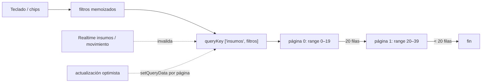

# Fase 3 · Desarrollo: Pantalla de inventario (lista paginada y filtros)

> **POSCafé · Specs · Fase 3 · Desarrollo** · Índice general: [`../../README.md`](../../README.md)
> Código: `src/features/insumos/InventarioListScreen.tsx`, `InsumoDetalleScreen.tsx`, `InsumoFormScreen.tsx`, `FotoInsumoScreen.tsx`, `src/hooks/useInsumos.ts`, `src/services/insumos.ts`, `src/components/InsumoCard.tsx`, `StockBadge.tsx`.

## 1. Lista (`InventarioListScreen`)

| Aspecto | Implementación |
|---|---|
| Datos | `useInsumos(filtros)` → `useInfiniteQuery` con clave `["insumos", filtros]` |
| Paginación | `TAMANO_PAGINA = 20`; `.range(p·20, p·20+19)`; `getNextPageParam`: hay siguiente página si la última devolvió exactamente 20 filas; `pageParam` = `todas.length` |
| Orden | `nombre` ascendente; solo `activo = true` |
| Búsqueda | `TextInput` con `useDebounce(busqueda, 300)`; `ilike nombre %q%` con `escaparLike` (`\`, `%`, `_`) |
| Filtro de estado | Chips (`Todos` / `Stock bajo` / `Agotado`) → `estado_stock = bajo\|agotado` |
| Filtro de categoría | Chips horizontales (`Todas las categorías` + `useCategorias`) → `categoria_id` |
| Render | `FlatList` + `InsumoCard` (`React.memo`, `onPress` estable con `useCallback`) |
| Fin de lista | `onEndReached` (umbral 0.5) → `fetchNextPage` si `hasNextPage && !isFetchingNextPage`; pie con `ActivityIndicator` |
| Refresco | `RefreshControl` (no se activa por la paginación) |
| Estados | Carga: `PantallaCarga`; error sin datos: `ErrorState` con *Reintentar*; vacío: «Sin inventario» o «Sin resultados» según haya filtros |
| Alta | Botón `+ Agregar` → `/inventario/form` |

> Con error pero datos en caché se muestran los datos (el error solo bloquea si la lista está vacía).

## 2. Tarjeta (`InsumoCard`) y estado (`StockBadge`)

| Estado | Condición (columna generada `estado_stock`) | Etiqueta |
|---|---|---|
| `ok` | `stock > mínimo` | (sin insignia en la tarjeta) |
| `bajo` | `0 < stock ≤ mínimo` | STOCK BAJO |
| `agotado` | `stock ≤ 0` | AGOTADO |

La tarjeta muestra foto (o la inicial del nombre), nombre, `Stock: N unidad (Mín: M)` con `formatearCantidad`, y resalta el valor si hay alerta. Accesibilidad: etiqueta `«<nombre>, <stock> <unidad>»`.

## 3. Detalle (`InsumoDetalleScreen`)

Recibe solo `insumoId` (ADR-06) y consulta `useInsumo`. Muestra datos, `QuickCounter` y últimos 5 movimientos (`useMovimientos`). Acciones: **Editar** (→ `/inventario/form?id`), **Foto** (→ `/scan-modal?insumoId`), **Desactivar** (solo administrador; confirmación con `useDialogo`; baja lógica `activo = false`). `useFocusEffect` refresca al volver.

## 4. Formulario (`InsumoFormScreen`)

| Campo | Regla |
|---|---|
| `nombre` | 2–80 (`LIMITES.nombreInsumo`) |
| `unidad_medida` | `UnidadMedida` (selector) |
| `stock_minimo` | ≥ 0, ≤ 999 999, 3 decimales |
| `categoria_id`, `proveedor_principal_id` | Opcionales |
| `stock_actual` | **Solo en alta** como «stock inicial»; se registra como movimiento `Ajuste de inventario` / nota «Stock inicial». El barista siempre crea con 0 (RLS `stock_actual = 0`) |
| Validación | `react-hook-form` + `zod`; `filtrarEntradaNumerica` en campos numéricos |

Resultado parcial: si el insumo se crea pero falla el stock inicial, se informa el motivo y el insumo permanece creado.

## 5. Foto (`FotoInsumoScreen`, ruta `/scan-modal`)

Permiso de cámara o galería (`expo-image-picker`) → `subirFotoInsumo` (1024 px, JPEG 0.7, ruta `<insumoId>/<timestamp>.jpg`) → `actualizarInsumo(id, { foto_url })` → invalida `["insumo", id]` e `["insumos"]`. Límite de bucket 2 MiB.

## 6. Reglas por rol

| Acción | Administrador | Barista |
|---|---|---|
| Ver lista y detalle | Sí | Sí (solo activos) |
| Crear | Sí | Sí (stock inicial 0) |
| Editar nombre, mínimo, categoría, proveedor | Sí | Sí |
| Subir foto | Sí | Sí |
| Desactivar | Sí | No (botón oculto; RLS lo rechaza) |

## 7. Pruebas

No hay pruebas de componentes para `InventarioListScreen` ni `InsumoCard`. Cobertura indirecta: utilidades (`formatearCantidad`, `acotarDelta`), pgTAP de RLS de insumos (`rls_y_stock.test.sql`).
