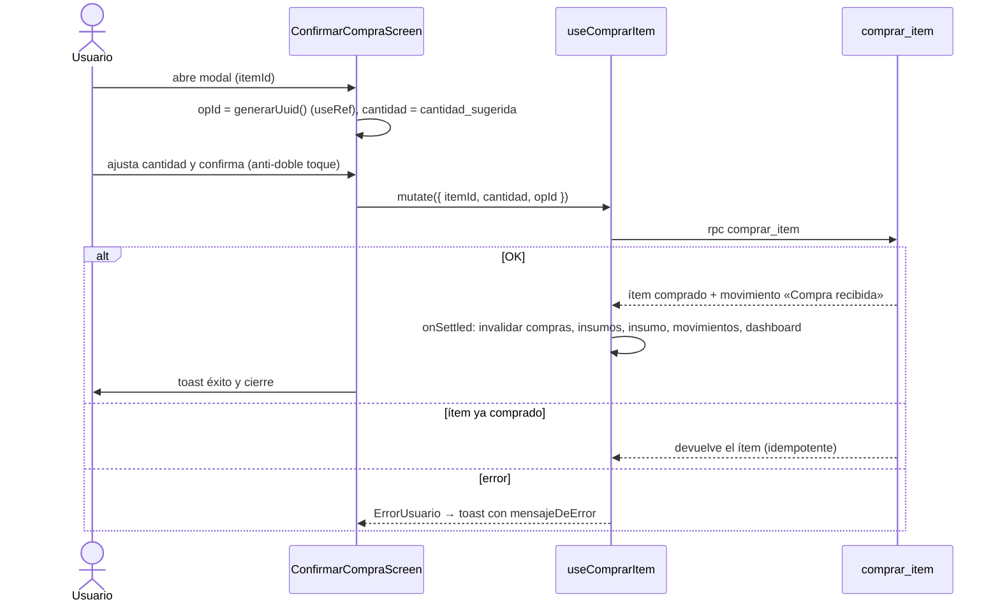
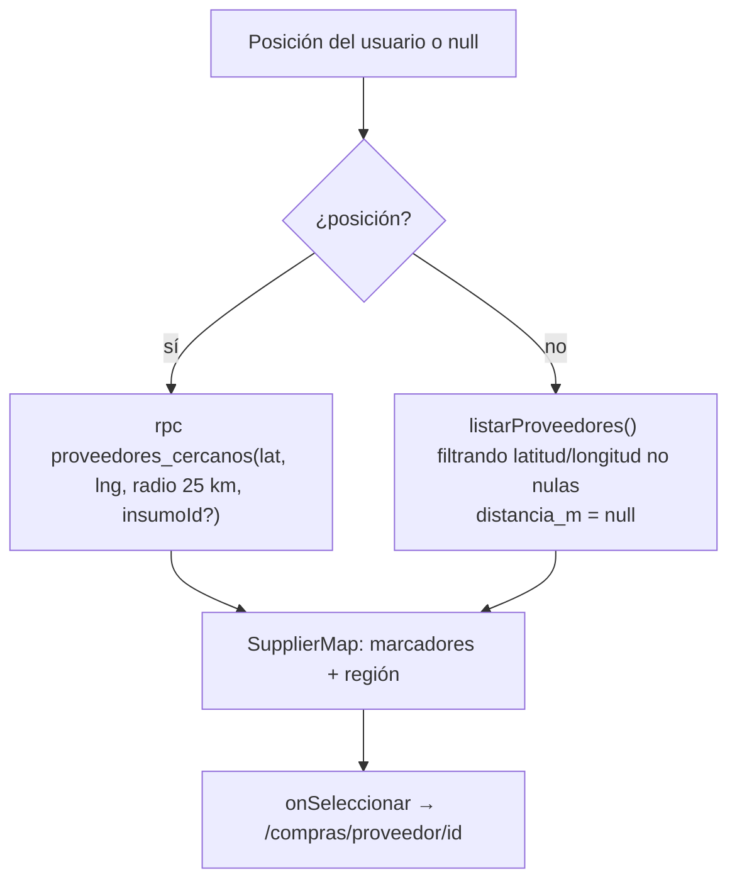

# Fase 3 · Desarrollo: Lista de compras y mapa de proveedores

> **POSCafé · Specs · Fase 3 · Desarrollo** · Índice general: [`../../README.md`](../../README.md)
> Código: `src/features/listaCompras/{ListaComprasScreen,ConfirmarCompraScreen}.tsx`, `src/features/proveedores/ProveedorDetalleScreen.tsx`, `src/hooks/{useCompras,useProveedores,useProveedoresCercanos}.ts`, `src/components/{ShoppingItem,SupplierMap,SelectorUbicacion}.tsx`, `src/services/{compras,proveedores,geocodificacion}.ts`.

## 1. Lista de compras

| Aspecto | Implementación |
|---|---|
| Datos | `useCompras()` → `["compras"]`; `listarCompras` devuelve solo `estado = 'pendiente'`, orden `creado_en` ascendente |
| Origen | `auto` (trigger `insumos_stock_bajo`) o `manual` (`agregarCompraManual`); insignia `AUTO`/`MANUAL` en `ShoppingItem` |
| Unicidad | Un pendiente por insumo (`lc_un_pendiente_por_insumo`); duplicado manual → «Este insumo ya está en tu lista de compras» (`codigo: "duplicado"`) |
| Alta manual | Modal de la pantalla con selector de insumos (`["insumos-todos"]`), cantidad validada (`validarCantidad`) y proveedor opcional |
| Marcar comprado | Casilla → `/confirmar-compra-modal?itemId` |
| Sincronización | Realtime sobre `lista_compras` invalida `["compras"]` |
| Proveedor | Si el ítem tiene proveedor, `onAbrirProveedor` → `/compras/proveedor/[proveedorId]` |

### 1.1 `ConfirmarCompraScreen`

**Sin cola offline:** `comprar_item` es una mutación `networkMode: "always"`; sin red falla con mensaje de conexión (ADR-10).

**Compra parcial:** si tras reintegrar el stock sigue `≤ mínimo`, el trigger crea un nuevo pendiente automático con la cantidad sugerida recalculada.

## 2. Proveedores

| Función | Permiso |
|---|---|
| Ver ficha, mapa e insumos asociados | Todos |
| Crear (`proveedorId = "nuevo"`), editar, eliminar, asociar/desasociar insumos | Administrador |

La ficha usa `react-hook-form` + `zod` (`nombre` 2–80, teléfono ≤ 20 y ≥ 7 dígitos, dirección ≤ 200, coordenadas en rango). `ID_NUEVO = "nuevo"` diferencia alta de edición. Tras guardar, `useGestionProveedores` invalida `["proveedores"]`, `["proveedor", id]` y `["proveedores-cercanos"]`.

## 3. Selección de ubicación (`SelectorUbicacion`)

| Capacidad | Detalle |
|---|---|
| Mapa | `react-native-maps` con pin arrastrable/tocable; región inicial centrada en México (`23.6345, −102.5528`, Δ 18°); zoom cercano `0.008` |
| Búsqueda de dirección | `buscarDireccion` (geocodificador del sistema; mínimo 4 caracteres) |
| Dirección desde el pin | `direccionDeCoordenada` (nunca lanza); solo reemplaza el texto si estaba vacío o fue sugerido automáticamente (`direccionAutomatica`) |
| Posición inicial | Última posición conocida **sin pedir permisos** (solo si ya estaban concedidos) |
| «Usar mi ubicación» | Solicita permiso de primer plano; si se deniega, `informar` con acción «Abrir Ajustes» |
| Scroll | `onInteraccion` evita el desplazamiento de la pantalla mientras se toca el mapa |

## 4. Mapa de proveedores cercanos (`SupplierMap`)

| Aspecto | Detalle |
|---|---|
| Clave de caché | `["proveedores-cercanos", lat≈, lng≈, insumoId]` con `redondearPosicion` (evita una consulta por cada movimiento mínimo del GPS) |
| Cálculo de distancia | Haversine en SQL (sin PostGIS); radio por defecto SQL 10 km, el servicio envía 25 km (H-09) |
| Proveedores sin coordenadas | No aparecen en el mapa; la lista indica «Sin ubicación: no aparece en el mapa» (RN-13) |
| Formato de distancia | `< 1000 m` → `N m`; si no `N.N km`; `null` → cadena vacía |
| Región | Calculada para englobar marcadores (delta mínimo 0.02°); por defecto México |
| Filtro por insumo | Con `insumoId`, solo proveedores asociados en `proveedor_insumos` |

## 5. Cantidad sugerida (recordatorio)

`greatest(stock_minimo × 2 − stock_actual, 1)` en el trigger. En la alta manual desde la ficha de proveedor el valor por defecto es `max(stock_minimo, 1)`.

## 6. Pruebas

| Elemento | Prueba |
|---|---|
| Geocodificación (`formatearDireccion`, `buscarDireccion`) | `__tests__/geocodificacion.test.ts` |
| `comprar_item`, índice único, trigger | pgTAP `rls_y_stock.test.sql` (casos de compra e idempotencia) |
| Haversine (`proveedores_cercanos`) | pgTAP casos 23–24 |
| Pantallas y `SupplierMap` | Sin pruebas automatizadas |
