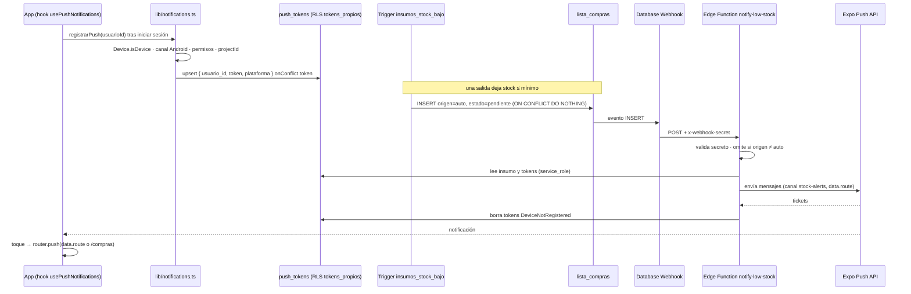

# Fase 3 · Desarrollo: Notificaciones push

> **POSCafé · Specs · Fase 3 · Desarrollo** · Índice general: [`../../README.md`](../../README.md)
> Código: `src/lib/notifications.ts`, `src/hooks/usePushNotifications.ts`, `src/services/pushTokens.ts`, `supabase/functions/notify-low-stock/index.ts`, tabla `push_tokens`.

## 1. Flujo extremo a extremo

## 2. Registro del token (`registrarPush`)

| Paso | Regla |
|---|---|
| 1 | `Device.isDevice`: los simuladores no reciben push → sale sin error |
| 2 | Android: crea el canal `stock-alerts` («Alertas de stock», importancia alta, vibración `[0,250,250,250]`) |
| 3 | `getPermissionsAsync`; si no está concedido pide permiso; si se deniega, termina |
| 4 | `projectId` desde `extra.eas.projectId` o `easConfig.projectId`; si falta o empieza por `REEMPLAZA` → `console.warn("Push desactivado…")` y termina |
| 5 | `getExpoPushTokenAsync({ projectId })` → guarda `tokenActual` y llama `guardarPushToken` (`upsert` con `onConflict: token`) |
| Errores | Todo en `try/catch`: **nunca lanza**; solo `console.warn` |

`desregistrarPush()` elimina el token del dispositivo **antes** de `signOut` (la RLS de `push_tokens` exige sesión). Si no hay `tokenActual`, no hace nada.

## 3. Recepción y navegación (`usePushNotifications`)

| Escenario | Manejo |
|---|---|
| App cerrada y abierta desde la notificación | `getLastNotificationResponse()` → navega |
| App abierta o en segundo plano | `addNotificationResponseReceivedListener` |
| Destino | `data.route` si es cadena que empieza por `/`; en otro caso `/compras` |

Se monta en `(app)/_layout.tsx` y solo actúa con sesión (`usuarioId` definido).

## 4. Edge Function `notify-low-stock` (`Deno.serve`)

| Aspecto | Detalle (verificado en `index.ts`) |
|---|---|
| Disparador | Database Webhook `lista_compras · INSERT` (configuración **no versionada**, ❔ H-06) |
| Autenticación | Si `x-webhook-secret` ≠ `WEBHOOK_SECRET` → `403 forbidden` |
| Variables | `SUPABASE_URL`, `SUPABASE_SERVICE_ROLE_KEY`, `WEBHOOK_SECRET` (dependencia `@supabase/supabase-js` declarada en `deno.json`) |
| Filtro RN-12 | Sin `record` o `record.origen !== "auto"` → responde `"omitido"` |
| Datos | Lee `insumos` (`nombre, stock_actual, unidad_medida, estado_stock`) y **todos** los `push_tokens` (H-12); sin datos o tokens → `"sin destinatarios"` |
| Mensaje | `sound: "default"`, `channelId: "stock-alerts"`; título `Agotado: <nombre>` si `estado_stock = agotado`, si no `Stock bajo: <nombre>`; cuerpo `Quedan <stock> <unidad>. Se agregó a la lista de compras.`; `data: { route: "/compras", itemId }` |
| Envío | `POST https://exp.host/--/api/v2/push/send` con el arreglo de mensajes |
| Limpieza | Elimina de `push_tokens` los tokens con ticket `error` / `DeviceNotRegistered` |
| Respuesta | Cuerpo de Expo con su mismo estado HTTP |

## 5. Garantías y límites

| Tema | Estado |
|---|---|
| Sin duplicados mientras haya un pendiente | ✅ `ON CONFLICT DO NOTHING` ⇒ no hay `INSERT` ⇒ no hay evento (RN-12) |
| Ítems manuales no notifican | ✅ filtro `origen` |
| Notificación con app en primer plano | 🔄 depende del *handler* configurado en `lib/notifications.ts` |
| Dispositivos simulados | No soportado (por diseño) |
| Entrega garantizada | No: Expo Push es *best effort* |
| Verificación del webhook | ❔ no hay evidencia en el repositorio |
| `projectId` real | ⬜ `app.json` contiene marcador `REEMPLAZA_…` |

## 6. Pruebas

No hay pruebas automatizadas del registro ni de la Edge Function. El comportamiento del trigger sí se cubre en pgTAP (ítem automático y no duplicación).
