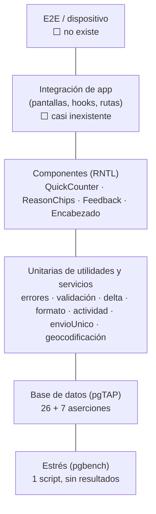

# Fase 4 · Pruebas: Pirámide y matriz de pruebas

> **POSCafé · Specs · Fase 4 · Pruebas** · Índice general: [`../../README.md`](../../README.md)
> Inventario real de pruebas (`__tests__/`, `tests/`, `supabase/tests/`) y brechas. No se afirman recuentos de casos Jest que no se hayan podido verificar; los números de pgTAP son exactos (`plan(26)` y `plan(7)`).

## 1. Pirámide

## 2. Inventario de archivos

### 2.1 Jest — `__tests__/` (9 archivos)

| Archivo | Tipo | Objeto de prueba |
|---|---|---|
| `actividad.test.ts` | Unitaria | `tiempoRelativo`, `describirMovimiento` |
| `Encabezado.test.tsx` | Componente | `Encabezado`: título, ausencia de «Volver» en raíz, retroceso |
| `errores.test.ts` | Unitaria | `mensajeDeError`, `MENSAJES` (tono, brevedad, sin jerga), códigos y `ErrorUsuario` |
| `Feedback.test.tsx` | Componente | `FeedbackProvider`: toast, diálogo (`confirmar`/`informar`), `Aviso`, hooks fuera del proveedor |
| `geocodificacion.test.ts` | Unitaria (servicio con *mock*) | `buscarDireccion`, `direccionDeCoordenada`, `formatearDireccion` |
| `QuickCounter.test.tsx` | Componente | Acotado a stock, chip suma, pulsación larga resta, proyección |
| `ReasonChips.test.tsx` | Componente | 5 motivos y selección |
| `traducirError.test.ts` | Unitaria | Delegación de `traducirError` en el traductor central |
| `utils.test.ts` | Unitaria | `formatearDistancia`, `parsearNumero`, `formatearCantidad`, RN-01, CA-01 (10 − 6 = 4), `generarUuid` |

### 2.2 Jest — `tests/` (4 archivos)

| Archivo | Objeto de prueba |
|---|---|
| `envioUnico.test.ts` | `crearBloqueo`: doble toque, enfriamiento, promesa pendiente, promesa fallida, función que lanza |
| `utils_baseline.test.ts` | Regresión de `parsearNumero` (`0x10`, `1e3` → 0) |
| `utils.test.ts` | Modo avión (errores de red), formato, delta/stock, actividad con datos incompletos |
| `validacion.test.ts` | `LIMITES`, `validarTexto`, `validarCantidad`, `validarCorreo`, `validarTelefono`, `filtrarEntradaNumerica`, `normalizarTexto` |

### 2.3 Base de datos — `supabase/tests/`

| Archivo | Tipo | Aserciones |
|---|---|---|
| `database/rls_y_stock.test.sql` | pgTAP | `plan(26)` (24 casos numerados; el caso 14 agrupa 3) |
| `database/limites_de_entrada.test.sql` | pgTAP | `plan(7)` (5 `throws_ok` + 2 `lives_ok`) |
| `concurrencia.pgbench.sql` | pgbench | Script de estrés (ver [05](05-pruebas-de-estres-de-concurrencia-for-update.md)) |

## 3. Matriz regla/requisito ↔ prueba

| Elemento | Jest | pgTAP | Estrés | Cobertura |
|---|---|---|---|---|
| RN-01 stock no negativo | `utils.test.ts` (RN-01, delta/stock), `QuickCounter.test.tsx` | Casos 10-11 | pgbench (escenario 2) | ✅ |
| RN-02 un movimiento por cambio | — | Casos 3-6 | pgbench (conteo) | ✅ |
| RN-03 stock solo por RPC | — | Casos 13, 17 | — | ✅ |
| RN-04 idempotencia | `envioUnico.test.ts` (UI) | Casos 15-16, 20-21 | — | ✅ |
| RN-05 motivos | `ReasonChips.test.tsx` | Caso 12 | — | ✅ |
| RN-06 un pendiente por insumo | — | Casos 7-9 | — | ✅ |
| RN-07 estado y sugerido | — | Casos 5-6, 18-19 (sugerido = 6) | — | ✅ |
| RN-08 comprar | — | Casos 18-21 | — | ✅ |
| RN-09 rol no autoasignable | — | Casos 1-2 | — | ✅ |
| RN-10 permisos de barista | — | Caso 14 (+ 13, 17, 22) | — | 🔄 (editar insumo por barista y escritura de proveedores sin caso explícito) |
| RN-11 historial inmutable | — | Caso 13 (sin `INSERT` directo) | — | 🔄 |
| RN-12 push solo auto | — | Casos 7-9 (trigger) | — | 🔄 (Edge Function sin prueba) |
| RN-13 proveedores sin coordenadas | — | Casos 23-24 (orden y radio) | — | 🔄 |
| RN-14 límites | `validacion.test.ts`, `errores.test.ts` (22003) | `limites_de_entrada.test.sql` | — | ✅ |
| RN-15 incrementos | — | — | — | ⬜ (`useUiStore` sin prueba) |
| RN-16 fotos | — | — | — | ⬜ |
| RN-17…RN-20 (offline, feedback, errores) | `errores.test.ts`, `Feedback.test.tsx` | — | — | 🔄 (la cola offline no tiene prueba) |
| RF-03 recuperación de contraseña | — | — | — | n/a (no implementado) |
| Guardas de rutas y rol en UI | — | — | — | ⬜ ([ver 03](03-pruebas-de-rutas-y-guardas-expo-router.md)) |
| Haversine | — | Casos 23-24 | — | ✅ |
| Reportes solo admin | — | Caso 22 | — | ✅ |

## 4. Brechas principales (H-14, H-19)

1. Sin pruebas de rutas, guardas, `useRegistrarMovimiento`, cola offline, Login/Register, pantallas por rol, Dashboard ni `useUiStore`.
2. `npm test` ejecuta `jest.app.config.js`, que solo recoge `tests/**/*.test.ts` (H-19): las pruebas de `__tests__/` requieren `npx jest` (config por defecto).
3. El script `pgbench` carece de resultados registrados.
4. Sin pruebas de la Edge Function ni del registro de push.
5. Sin umbral de cobertura configurado (`collectCoverageFrom` existe en `jest.app.config.js`, sin `coverageThreshold`).
