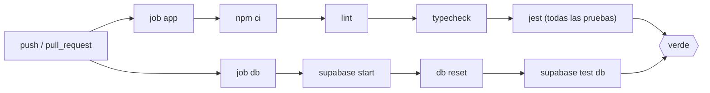

# Fase 4 · Pruebas: Pipeline de CI (GitHub Actions)

> **POSCafé · Specs · Fase 4 · Pruebas** · Índice general: [`../../README.md`](../../README.md)
> El repositorio contiene `.github/workflows/ci.yml`, pero **su contenido no forma parte del volcado** (H-06). Lo siguiente combina scripts reales de `package.json` con el diseño propuesto en los documentos históricos; lo no verificable se marca ❔.

## 1. Scripts reales disponibles (`package.json`)

| Script | Comando | Uso en CI |
|---|---|---|
| `lint` | `eslint .` (`eslint-config-expo/flat`; ignora `dist`, `supabase`, `.expo`, `node_modules`, `jest.setup.js`, `jest.config.js`) | Calidad |
| `typecheck` | `tsc --noEmit` | Tipos y rutas tipadas |
| `test` | `jest --ci -c jest.app.config.js` | Pruebas de `tests/` (solo; H-19) |
| `test:db` | `supabase test db supabase/tests/database` | pgTAP |

## 2. Pipeline propuesto (documentos históricos; ❔ no verificado)

```yaml
# .github/workflows/ci.yml (propuesto)
name: CI
on: [push, pull_request]
jobs:
  app:
    runs-on: ubuntu-latest
    steps:
      - uses: actions/checkout@v4
      - uses: actions/setup-node@v4
        with: { node-version: 20, cache: npm }
      - run: npm ci
      - run: npm run lint
      - run: npm run typecheck
      - run: npx jest --ci --coverage      # config por defecto: incluye __tests__/ y tests/
  db:
    runs-on: ubuntu-latest
    steps:
      - uses: actions/checkout@v4
      - uses: supabase/setup-cli@v1
        with: { version: latest }
      - run: supabase start
      - run: supabase db reset
      - run: npm run test:db
```



## 3. Puntos de atención

| Tema | Detalle |
|---|---|
| Cobertura real de Jest | Si el CI usa `npm test`, se omiten las pruebas de `__tests__/` (H-19). Se recomienda `npx jest --ci` o unificar `testMatch` |
| Node | Expo 58 / RN 0.88 exige una versión de Node moderna; 20 es la del diseño histórico ❔ (comprobar `engines`/`.npmrc` y requisitos de Expo) |
| Base de datos | `supabase db reset` aplica las 5 migraciones y `seed.sql`; el seed incluye `UPDATE insumos SET stock_minimo = stock_minimo` para disparar el trigger en insumos nacidos bajo el mínimo (H-02) |
| `pgbench` | No está en el pipeline |
| Secretos | Las pruebas usan valores falsos (`jest.setup.js`); la BD de CI es local (no hay claves reales) |
| EAS | `eas.json` define builds; no hay evidencia de despliegue automatizado |

## 4. Criterios de «pipeline verde»

1. `eslint` sin errores.
2. `tsc --noEmit` sin errores (incluye `typedRoutes`).
3. Todas las pruebas Jest verdes (ambas carpetas).
4. `supabase test db`: 26 + 7 aserciones superadas.
