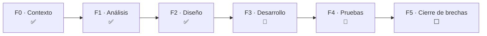

# Ruta de ejecución

> **POSCafé · Specs · Guía** · Índice general: [`../README.md`](../README.md)
> Orden recomendado para llevar el proyecto desde cero hasta una versión verificada, y para cerrar las brechas abiertas. Estado reconstruido contra el código.

## 1. Fases y estado

| Fase | Resultado | Estado | Documento |
|---|---|---|---|
| F0 | ADR, convenciones, estado actual | ✅ | [`../00-contexto/`](../00-contexto/estado-actual.md) |
| F1 | RN/RF/RNF, CU, HU/CA, trazabilidad | ✅ | [`../fase-1-analisis.md`](../fase-1-analisis.md) |
| F2 | Datos, funciones, seguridad, arquitectura, contratos, navegación | ✅ | [`../fase-2-diseno.md`](../fase-2-diseno.md) |
| F3 | Aplicación y backend implementados | 🔄 (RF-03 no; RF-08 parcial; H-01) | [`../fase-3-desarrollo.md`](../fase-3-desarrollo.md) |
| F4 | Pruebas | 🔄 (brechas H-14, H-19) | [`../fase-4-pruebas.md`](../fase-4-pruebas.md) |

## 2. Secuencia de trabajo (hitos)

| Hito | Contenido | Dependencias | Verificación |
|---|---|---|---|
| H1 · Base | Proyecto Expo, `supabaseClient`, tipos, tema | — | `npm run typecheck` |
| H2 · Datos | Migraciones 0001–0002 y seed | H1 | `supabase db reset`; `test:db` casos 1-24 |
| H3 · Auth y navegación | `authStore`, layouts, guardas | H1-H2 | Registro y login; redirecciones |
| H4 · Inventario y contador | Lista paginada, detalle, `QuickCounter`, `registrar_movimiento`, optimista | H2-H3 | pgTAP 3-12, 15-16; pruebas de componentes |
| H5 · Offline | Caché persistida, cola de movimientos, banner | H4 | Prueba manual M-01 |
| H6 · Compras y proveedores | Trigger, `comprar_item`, mapa | H4 | pgTAP 7-9, 18-24 |
| H7 · Dashboard y reportes | RPC de dashboard y reporte admin | H4 | Manual + pgTAP 22 |
| H8 · Push y Realtime | Edge Function, webhook, tokens, canales | H6 | Manual M-02, M-03 |
| H9 · Roles ampliados | Migración 0003 (barista crea/edita) | H2 | pgTAP 14; UI por rol |
| H10 · Endurecimiento | Límites de entrada (0005), feedback centralizado, errores | H1-H9 | `limites_de_entrada.test.sql`; `validacion.test.ts` |
| H11 · Calidad | Jest, pgTAP, pgbench, CI | H1-H10 | Pipeline verde |

## 3. Plan de cierre de brechas (priorizado)

| Prioridad | Acción | Referencia |
|---|---|---|
| 1 | Hacer que `npm test` ejecute todas las pruebas Jest | H-19, QA-13 |
| 2 | Pruebas de `useRegistrarMovimiento`, reintento `23505` y cola offline | QA-09…QA-11 |
| 3 | Pruebas de guardas de Expo Router | QA-06 |
| 4 | Ejecutar y registrar `pgbench` (dos escenarios) | QA-08 |
| 5 | Corregir etiqueta del gráfico semanal | H-01, V-21 |
| 6 | Trigger para insumos nacidos bajo el mínimo | H-02, D-13 |
| 7 | Versionar webhook, `config.toml` y secretos de ejemplo | H-06, A-15, D-16 |
| 8 | Procedimiento y salvaguarda para el último administrador | H-07, A-06 |
| 9 | Parametrizar zona horaria y radio | H-08, H-09, D-14 |
| 10 | Recuperación de contraseña e historial completo | H-11, H-10 |
| 11 | Revisar clasificación `23514` y validación explícita de tope | H-13, H-16 |
| 12 | Retirar `@react-navigation/native-stack` y el import desde `.expo/` | H-15, H-17 |

## 4. Definición de «hecho» por incremento

1. Código con tipos y lint limpios.
2. Regla de negocio identificada (RN/RF) y su mecanismo en BD/app.
3. Prueba automatizada (Jest o pgTAP) o caso manual registrado.
4. Fila actualizada en la [matriz de trazabilidad](../01-analisis/diseno/03-matriz-de-trazabilidad.md).
5. Documentación actualizada con el encabezado estándar y enlaces válidos.
