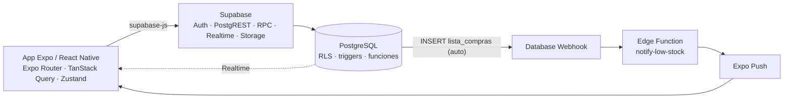

# POSCafé · Especificaciones (ingeniería inversa del código)

> **POSCafé · Specs** · Índice general

## 1. ¿Qué es POSCafé?

Aplicación móvil de **control de inventario para cafeterías** (React Native + Expo Router + TypeScript, TanStack Query, Zustand, Supabase). Permite registrar entradas y salidas de insumos en pocos toques, ver alertas de stock bajo, gestionar compras y proveedores (con mapa), recibir notificaciones push y consultar un dashboard. Hay dos roles: **administrador** y **barista**.

## 2. Mapa de documentos

| Carpeta / archivo | Contenido |
|---|---|
| [`00-contexto.md`](00-contexto.md) | Resumen de contexto |
| [`00-contexto/`](00-contexto/estado-actual.md) | [`adr.md`](00-contexto/adr.md) · [`convenciones.md`](00-contexto/convenciones.md) · [`estado-actual.md`](00-contexto/estado-actual.md) (hallazgos H-01…H-19) |
| [`fase-1-analisis.md`](fase-1-analisis.md) → [`01-analisis/`](01-analisis/requerimientos.md) | RN, RF, RNF; CU; HU/CA; trazabilidad; tareas |
| [`fase-2-diseno.md`](fase-2-diseno.md) → [`02-diseno/`](02-diseno/requerimientos.md) | Modelo de datos, funciones/triggers, RLS, arquitectura frontend, contratos, navegación, wireframes |
| [`fase-3-desarrollo.md`](fase-3-desarrollo.md) → [`03-desarrollo/`](03-desarrollo/requerimientos.md) | QuickCounter, inventario, compras y mapa, push, dashboard |
| [`fase-4-pruebas.md`](fase-4-pruebas.md) → [`04-pruebas/`](04-pruebas/requerimientos.md) | Pirámide, Jest, rutas, pgTAP, estrés, CI |
| [`guia-implementacion.md`](guia-implementacion.md) → [`05-guia/`](05-guia/GUIA_IMPLEMENTACION.md) | Guía de implementación y ruta de ejecución |

## 3. Árbol de archivos

```text
specs/
├─ README.md · 00-contexto.md · guia-implementacion.md
├─ fase-1-analisis.md · fase-2-diseno.md · fase-3-desarrollo.md · fase-4-pruebas.md
├─ 00-contexto/        adr · convenciones · estado-actual
├─ 01-analisis/        requerimientos · tareas · diseno/{01-casos-de-uso-principales, 02-historias-de-usuario, 03-matriz-de-trazabilidad}
├─ 02-diseno/          requerimientos · tareas · diseno/{01…07}
├─ 03-desarrollo/      requerimientos · tareas · diseno/{01…05}
├─ 04-pruebas/         requerimientos · tareas · diseno/{01…06}
└─ 05-guia/            GUIA_IMPLEMENTACION · ruta-de-ejecucion
```

## 4. Arquitectura en una vista



## 5. Cifras clave (verificadas en los documentos)

| Elemento | Cantidad |
|---|---|
| Reglas de negocio · Requerimientos funcionales · No funcionales | RN-01…RN-20 · RF-01…RF-22 · RNF-01…RNF-13 |
| Casos de uso · Historias · Criterios de aceptación | CU-01…CU-15 · HU-01…HU-14 · CA-01…CA-30 |
| Tablas con RLS · Funciones SQL · Triggers de aplicación | 8 · 14 · 6 (+ `al_crear_usuario`) |
| Migraciones | 5 (`20261001…` a `20261122…`) |
| Rutas · Pestañas | 16 · 4 |
| Pruebas | 13 archivos Jest · pgTAP `plan(26)` + `plan(7)` · 1 script pgbench |
| Hallazgos | H-01…H-19 |

## 6. Cobertura de requerimientos (resumen)

RF: **20 implementados**, **1 parcial** (RF-08 historial) y **1 no implementado** (RF-03 recuperación de contraseña). Detalle en [`01-analisis/requerimientos.md`](01-analisis/requerimientos.md#4-resumen-de-cobertura).

## 7. Evolución respecto a la idea original (resumen)

| Tema | Original | Código actual |
|---|---|---|
| Permisos del barista | Solo mueve stock (RN-10 original) | **Crea y edita insumos** (stock inicial 0) por la migración `20261015000000` y ADR-08; **no** desactiva ni edita `stock_actual` |
| Idempotencia | Propuesta de «migración 0003» | No existe; el cliente reintenta una vez tras 400 ms ante `23505` (H-04) |
| Bucket de fotos | Lectura autenticada | **Público** (H-05) |
| Navegación | React Navigation | Expo Router (ADR-01) |
| ADR-05/06 | Por aplicar | Aplicadas |
| Límites de entrada | No contemplados | `LIMITES` + migración `20261122000000` |

## 8. Leyenda

✅ hecho y verificable · 🔄 parcial · ⬜ no encontrado · ⛔ descartado · ❔ no verificable con el material disponible (webhook, secretos, `config.toml`, `ci.yml`, `.gitignore`, `.env.example`, `CAMBIOS.md`) · 🆕 derivado del código. Prioridades MoSCoW en [`convenciones.md`](00-contexto/convenciones.md).

## 9. Cómo usar esta documentación

1. Empiece por [`estado-actual.md`](00-contexto/estado-actual.md) para ver módulos y hallazgos.
2. Consulte la [matriz de trazabilidad](01-analisis/diseno/03-matriz-de-trazabilidad.md) para ir de un requerimiento a su código y prueba.
3. Para poner en marcha el sistema, siga [`GUIA_IMPLEMENTACION.md`](05-guia/GUIA_IMPLEMENTACION.md).
