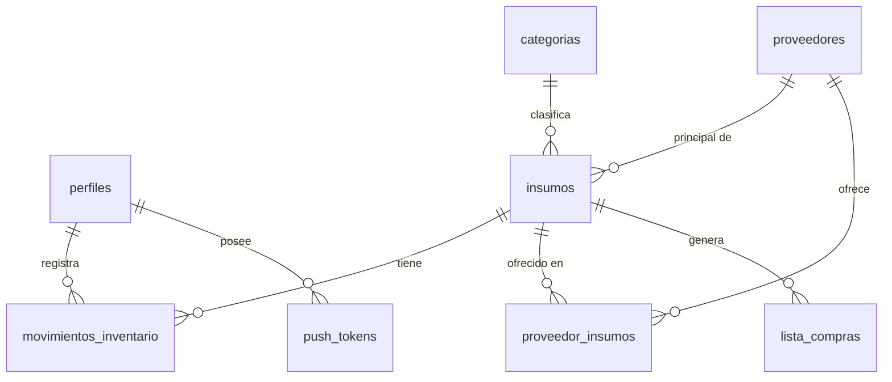

# Fase 2 · Diseño

> **POSCafé · Specs · Fase 2 · Diseño** · Índice general: [`README.md`](README.md)

## 1. Documentos

| Documento | Contenido |
|---|---|
| [`01-modelo-de-datos…`](02-diseno/diseno/01-modelo-de-datos-resumen-del-estado-final.md) | ERD, DDL consolidado, índices, Storage, Realtime |
| [`02-funciones-y-triggers…`](02-diseno/diseno/02-funciones-y-triggers-migracion-0002.md) | 14 funciones, triggers, secuencias de `registrar_movimiento`, `comprar_item`, alta de usuario |
| [`03-seguridad-rls…`](02-diseno/diseno/03-seguridad-rls-resumen.md) | Matriz por rol, 18 políticas en `public` + 4 en `storage.objects` |
| [`04-arquitectura-frontend`](02-diseno/diseno/04-arquitectura-frontend.md) | Capas, proveedores, caché, estado, feedback, componentes, tema |
| [`05-contratos-de-api`](02-diseno/diseno/05-contratos-de-api.md) | Servicios, RPC, Storage, Edge Function, errores |
| [`06-navegacion…`](02-diseno/diseno/06-navegacion-con-expo-router-y-guardas-por-rol.md) | Árbol de rutas y guardas |
| [`07-wireframes-estructura`](02-diseno/diseno/07-wireframes-estructura.md) | Estructura de pantallas |
| [`02-diseno/requerimientos.md`](02-diseno/requerimientos.md) · [`tareas.md`](02-diseno/tareas.md) | RD-01…RD-20 y D-01…D-16 |

## 2. Decisiones de diseño centrales

| Decisión | Mecanismo |
|---|---|
| Stock consistente | `FOR UPDATE` + bandera transaccional `app.aplicando_movimiento` + `insumos_proteger_stock` |
| Idempotencia | `client_op_id` único parcial (`mov_client_op_uidx`) |
| Alertas | `insumos_stock_bajo` → `lista_compras` (`ON CONFLICT DO NOTHING`) → webhook → push |
| Seguridad | RLS en 8 tablas; rol asignado por el servidor; tres capas |
| Offline | Solo `registrar_movimiento` se encola; consultas con caché persistida 24 h |
| Proximidad | Haversine en SQL |

## 3. Modelo de datos (vista)

Relaciones simplificadas; el ERD completo con columnas está en el documento 01.

## 4. Brechas de diseño abiertas

H-02 (trigger solo `AFTER UPDATE`), H-04 (búsqueda de `client_op_id` previa al bloqueo), H-08/H-09 (zona horaria y radio), H-13/H-16 (clasificación `23514` y tope no validado explícitamente).
