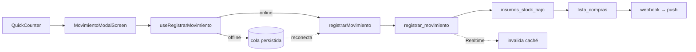

# Fase 3 · Desarrollo

> **POSCafé · Specs · Fase 3 · Desarrollo** · Índice general: [`README.md`](README.md)

## 1. Documentos

| Documento | Módulo |
|---|---|
| [`01-quickcounter-stepper-chips`](03-desarrollo/diseno/01-quickcounter-stepper-chips.md) | `QuickCounter`, `ReasonChips`, modal de movimiento, cola offline |
| [`02-pantalla-de-inventario…`](03-desarrollo/diseno/02-pantalla-de-inventario-lista-paginada-y-filtros.md) | Lista paginada, filtros, detalle, formulario, foto |
| [`03-lista-de-compras…`](03-desarrollo/diseno/03-lista-de-compras-y-mapa-de-proveedores.md) | Compras, proveedores, selector de ubicación, mapa |
| [`04-notificaciones-push`](03-desarrollo/diseno/04-notificaciones-push.md) | Registro de token, Edge Function, deep link |
| [`05-dashboard`](03-desarrollo/diseno/05-dashboard.md) | Resumen, consumo semanal, actividad, reportes |
| [`requerimientos.md`](03-desarrollo/requerimientos.md) · [`tareas.md`](03-desarrollo/tareas.md) | RDV-01…RDV-22 y V-01…V-23 |

## 2. Estado por módulo

| Módulo | Estado | Observación |
|---|---|---|
| Autenticación y navegación | ✅ | Guardas por layout y `SoloAdmin` |
| Contador rápido | ✅ | Optimista, rollback, `opId`, cola offline |
| Inventario | ✅ | Paginación 20, debounce 300 ms |
| Compras y proveedores | ✅ | `comprar_item` idempotente |
| Push | 🔄 | Webhook no versionado (H-06) |
| Dashboard | 🔄 | Etiquetas del gráfico (H-01) |
| Perfil y administración | ✅ | H-07 |

## 3. Flujo transversal de un movimiento

## 4. Brechas

RF-03 (recuperación de contraseña), RF-08 (historial completo), H-01, H-15 y H-17.
