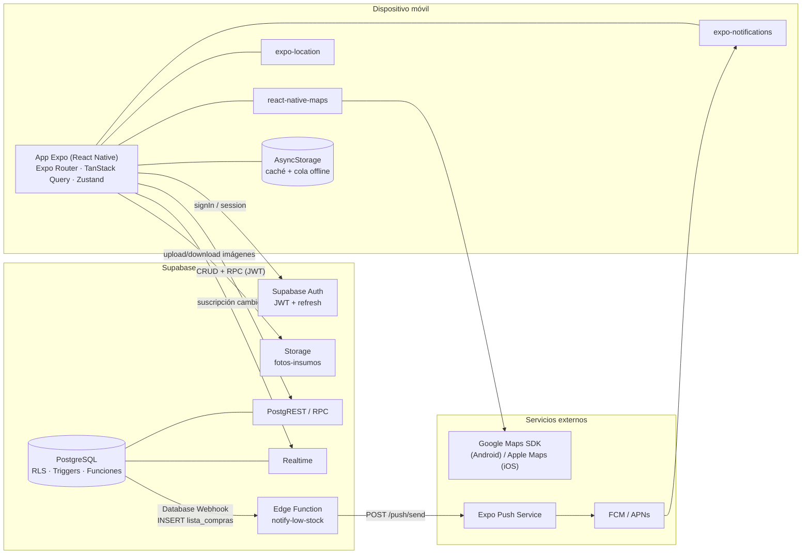
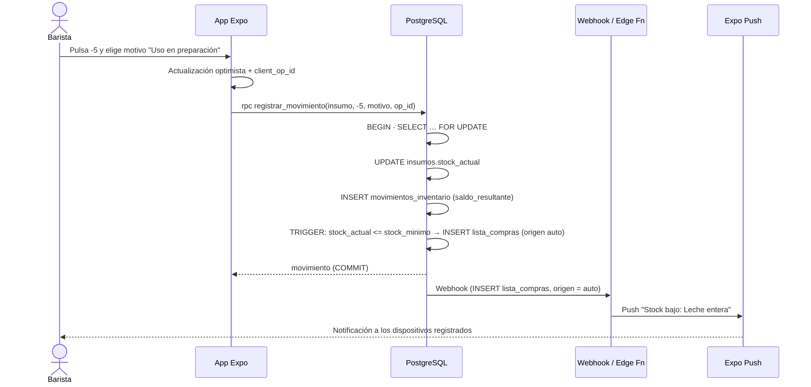
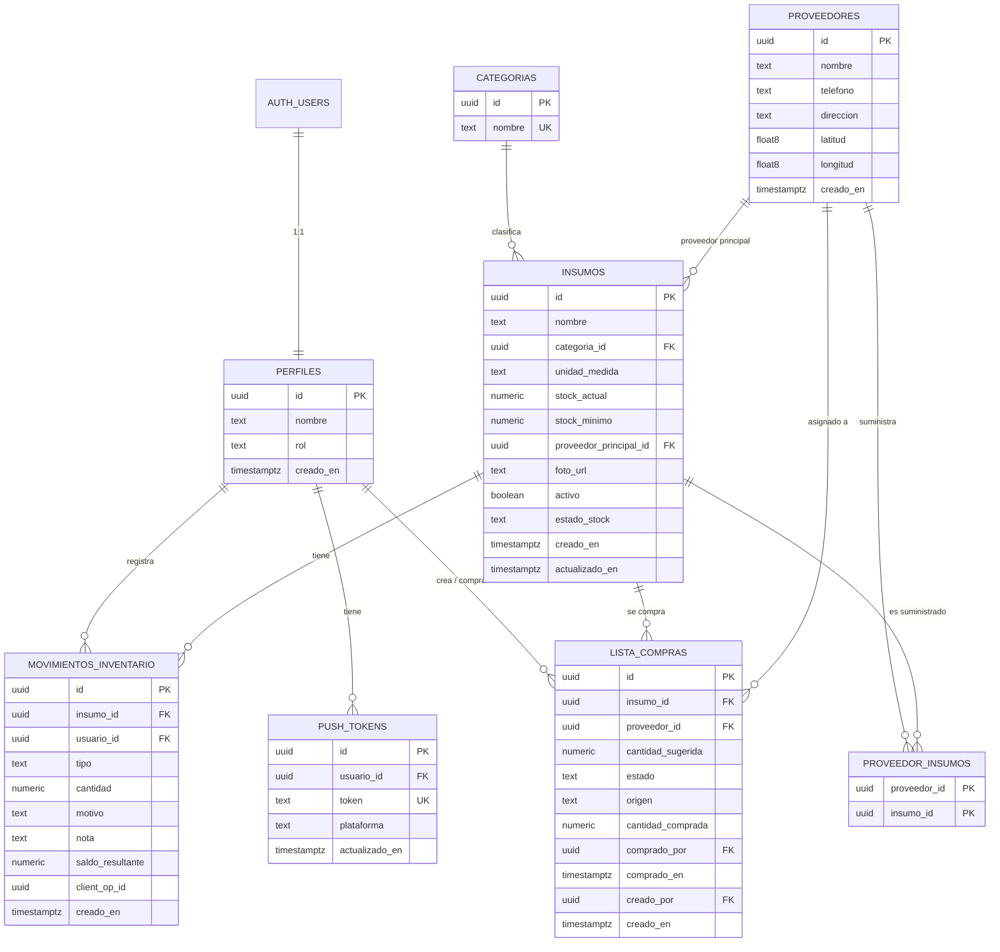

# POSCafé: Documento de Diseño de Software (SDD)

**Sistema de Gestión de Insumos para Cafeterías**
Versión 1.1 · Stack: React Native + Expo · Supabase (PostgreSQL, Auth, RLS, Realtime, Storage)

> **Control de cambios v1.1:** el documento se alineó con el **esquema real** del proyecto (nombres en español: `perfiles`, `insumos`, `lista_compras`…). Cambios principales: valores reales de los CHECK (motivos en español, `tipo` solo `entrada`/`salida`), coordenadas `latitud`/`longitud` con Haversine (sin PostGIS), `categorias` como tabla, corrección de seguridad del alta de perfil (el rol ya no viene del cliente) y migración `0002_endurecimiento_poscafe.sql`.

---

## 1. Introducción y objetivos del diseño

### 1.1 Propósito
Este documento define el diseño técnico de **POSCafé**, una aplicación móvil para administrar el inventario de insumos de una cafetería (café, leche, jarabes, vasos, filtros, etc.). Cubre arquitectura, navegación, modelo de datos, seguridad (RLS), lógica de negocio en base de datos, contratos de API, notificaciones, geolocalización, pruebas y despliegue. Está escrito para implementarse directamente en VSCode con Expo y Supabase.

### 1.2 Visión general
POSCafé es un cliente móvil (Expo) que habla directamente con Supabase (BaaS). La lógica crítica (movimientos de stock, detección de stock bajo, reintegro por compra) vive **en PostgreSQL** como funciones y triggers. Así es atómica, consistente y no depende del cliente. Las alertas push se disparan desde un Database Webhook hacia una Edge Function que llama a la API de Expo Push.

### 1.3 Objetivos de diseño

| Objetivo | Estrategia de diseño |
|---|---|
| **Rendimiento online/offline** | TanStack Query con caché persistida (AsyncStorage), lectura offline y cola de mutaciones con idempotencia (`client_op_id`). Paginación por cursor en inventario. |
| **UX fluida para baristas** | "Contador rápido" con stepper grande, incrementos rápidos, *optimistic updates*, háptica y modal de motivo con chips. Cero formularios de edición para mover stock. |
| **Consistencia** | Movimiento + actualización de stock en una sola transacción SQL con bloqueo de fila (`FOR UPDATE`). |
| **Escalabilidad** | Índices adecuados, RPC en lugar de múltiples round-trips, Supabase administrado, lógica sin estado. |
| **Seguridad** | Supabase Auth (JWT), RLS en todas las tablas, escritura de stock solo vía RPC, rol imposible de autoasignarse, claves de mapas restringidas. |
| **Trazabilidad** | Historial inmutable de movimientos con saldo resultante (`balance_after`). |

### 1.4 Alcance y supuestos
- Un solo negocio (cafetería) por instancia. Multi-tenant queda como extensión futura (columna `org_id` + RLS).
- Barista puede marcar ítems de la lista de compras como comprados. La especificación indica que "el usuario" confirma la compra, y el reintegro de stock se hace por RPC controlado.
- El **primer usuario registrado** se convierte en `administrador`. Los siguientes nacen como `barista` y el administrador puede promoverlos. El rol **nunca** se acepta desde el cliente.
- El esquema ya existe en Supabase (migración base 0001); este diseño agrega la migración 0002 sin rehacer tablas.
- Notificaciones push remotas requieren un **development build / build de EAS**, no Expo Go.

---

## 2. Arquitectura general del sistema

### 2.1 Diagrama de alto nivel



### 2.2 Flujo: contador rápido y stock bajo



### 2.3 Patrones aplicados

**Frontend**
- **Component Pattern + Presentational/Container.** Componentes de UI puros (`QuickCounter`, `StockBadge`) y pantallas que orquestan datos.
- **Custom Hooks para lógica de negocio.** `useSupplies`, `useRegisterMovement`, `useShoppingList`, `useNearbySuppliers`, `useAuth`, `useRole`, `usePushRegistration`. Las pantallas no llaman a Supabase directamente.
- **Repository / Service layer.** `services/*.ts` encapsula `supabase-js` (única capa que conoce las tablas).
- **Estado del servidor: TanStack Query.** Caché, reintentos, invalidación, persistencia offline, mutaciones pausadas sin red.
- **Estado de cliente: Zustand.** Sesión/rol, preferencias, filtros del inventario, estado de UI efímero.
- **Guard de rutas por rol.** Layouts de Expo Router redirigen según sesión y rol.

**Backend (BaaS / serverless)**
- **Lógica en la base de datos** (RPC `SECURITY DEFINER` + triggers) para invariantes de negocio.
- **RLS como capa de autorización** (política por tabla y por rol).
- **Event-driven.** Trigger → fila en `lista_compras` → Database Webhook → Edge Function → Push.
- **Idempotencia.** `client_op_id` único evita duplicar movimientos al reintentar desde la cola offline.

### 2.4 Estructura del repositorio

```
poscafe/
├─ app/                         # Expo Router (ver §3)
├─ src/
│  ├─ components/               # QuickCounter, ReasonChips, SupplierMap, ...
│  ├─ hooks/                    # useSupplies, useRegisterMovement, ...
│  ├─ services/                 # insumos.ts, movimientos.ts, proveedores.ts, auth.ts
│  ├─ lib/                      # supabase.ts, queryClient.ts, notifications.ts
│  ├─ store/                    # authStore.ts, uiStore.ts (Zustand)
│  ├─ types/                    # database.types.ts (generado)
│  └─ utils/                    # format.ts, distance.ts
├─ supabase/
│  ├─ migrations/               # SQL versionado
│  ├─ functions/notify-low-stock/index.ts
│  ├─ tests/                    # pgTAP
│  └─ config.toml
├─ __tests__/                   # Jest + RNTL
├─ app.config.ts · eas.json · .env
```

---

## 3. Arquitectura de navegación y componentes (Expo)

### 3.1 Árbol de rutas (Expo Router)

```
app/
├─ _layout.tsx                      # Providers (QueryClient, Auth), splash, guard de sesión
├─ (auth)/                          # Stack, solo sin sesión
│  ├─ _layout.tsx
│  ├─ login.tsx
│  └─ register.tsx
├─ (app)/                           # Requiere sesión
│  ├─ _layout.tsx                   # Stack raíz autenticado (aloja modales)
│  ├─ (tabs)/
│  │  ├─ _layout.tsx                # Tabs: Dashboard · Inventario · Compras · Perfil
│  │  ├─ dashboard/
│  │  │  ├─ _layout.tsx             # Stack
│  │  │  ├─ index.tsx               # Totales, alertas, gráfico semanal
│  │  │  └─ reports.tsx             # Reportes de stock (solo admin)
│  │  ├─ inventory/
│  │  │  ├─ _layout.tsx             # Stack
│  │  │  ├─ index.tsx               # FlatList infinita + filtros + buscador
│  │  │  ├─ [supplyId].tsx          # Detalle de insumo (stepper)
│  │  │  └─ edit.tsx                # Crear/Editar insumo (admin y barista; ?id= para editar)
│  │  ├─ shopping/
│  │  │  ├─ _layout.tsx             # Stack
│  │  │  ├─ index.tsx               # TODO list + mapa de proveedores cercanos
│  │  │  └─ supplier/[supplierId].tsx   # Detalle de proveedor (mapa y ficha)
│  │  └─ profile/
│  │     └─ index.tsx               # Datos, configuración, cerrar sesión (+ gestión de usuarios para admin)
│  ├─ movement-modal.tsx            # presentation: 'modal' · registro rápido (?supplyId=)
│  ├─ scan-modal.tsx                # presentation: 'modal' · foto/escaneo al crear insumo
│  └─ purchase-confirm-modal.tsx    # presentation: 'modal' · confirmar compra (?itemId=)
└─ +not-found.tsx
```

**Mapa Stack / Tabs / Modal respecto a la especificación**

| Pantalla | Tipo | Ruta |
|---|---|---|
| Login, Registro | Stack (grupo `(auth)`) | `/(auth)/login`, `/(auth)/register` |
| Dashboard, Inventario, Lista de Compras, Perfil | Tabs | `/(app)/(tabs)/*` |
| Detalle de Insumo → Registro de Movimiento | Stack + Modal | `inventory/[supplyId]` → `movement-modal` |
| Crear/Editar Insumo | Stack (admin) | `inventory/edit` |
| Detalle de Proveedor | Stack | `shopping/supplier/[supplierId]` |
| Reportes | Stack (admin) | `dashboard/reports` |
| Escaneo/foto, Confirmación de compra | Modal | `scan-modal`, `purchase-confirm-modal` |

**Guard de sesión y rol** (`app/_layout.tsx`)

```tsx
export default function RootLayout() {
  const { session, loading } = useAuth();
  const segments = useSegments();
  const router = useRouter();

  useEffect(() => {
    if (loading) return;
    const inAuth = segments[0] === '(auth)';
    if (!session && !inAuth) router.replace('/(auth)/login');
    if (session && inAuth) router.replace('/(app)/(tabs)/dashboard');
  }, [session, loading, segments]);

  if (loading) return <SplashScreenHold />;
  return <Slot />;
}
```

En `inventory/edit.tsx` y `dashboard/reports.tsx`, un hook `useRole()` redirige a barista (`<Redirect href="/" />`). La seguridad real la imponen las políticas RLS y RPC, no la UI.

### 3.2 Componentes clave

| Componente | Responsabilidad |
|---|---|
| `QuickCounter` | Stepper central: botones −/+ grandes, `TextInput` numérico editable, chips de incremento rápido (configurables en Perfil → Configuración y guardados en el dispositivo; por defecto +1, +5, +10). Emite `delta`. |
| `ReasonChips` | Chips seleccionables: *Compra recibida, Uso en preparación, Merma/Vencido, Ajuste de inventario, Otro* (+ `TextInput` opcional para "Otro", que se envía como `nota`). El valor enviado es el texto exacto (constante `MOTIVOS`, CHECK en la base). |
| `MovementModal` | Compone `QuickCounter` + `ReasonChips` + saldo proyectado + botón Confirmar. |
| `StockBadge` | Estado visual: OK (verde), Stock bajo (ámbar), Agotado (rojo), desde `estado_stock` (`ok` / `bajo` / `agotado`). |
| `SupplyCard` / `SupplyList` | Fila de `FlatList` con foto, nombre, stock y badge. Memoizada. |
| `ShoppingListItem` | Checkbox, insumo, cantidad sugerida, proveedor, estado. Al marcar abre confirmación. |
| `SupplierMap` | `MapView` con `Marker` por proveedor, posición del usuario y callout con distancia. |
| `SupplierCard` | Ficha con contacto, distancia e insumos asociados con botón "Agregar a lista". |
| `WeeklyChart` | Gráfico de barras (p. ej. `react-native-gifted-charts` o `victory-native`) de consumo semanal. |
| `RoleGate` | Renderiza hijos solo si el rol coincide. |

**Contador rápido (esqueleto)**

```tsx
type Props = { current: number; unit: string; quick: number[]; onChange: (delta: number) => void };

export function QuickCounter({ current, unit, quick, onChange }: Props) {
  const [delta, setDelta] = useState(0);
  const step = (n: number) => { Haptics.selectionAsync(); setDelta(d => Math.max(-current, d + n)); };
  const projected = current + delta;

  useEffect(() => onChange(delta), [delta]);

  return (
    <View style={styles.wrap}>
      <Text style={styles.projected}>{projected} {unit}</Text>
      <View style={styles.row}>
        <Pressable accessibilityLabel="Restar" onPress={() => step(-1)} style={styles.btn}><Text>−</Text></Pressable>
        <TextInput
          keyboardType="decimal-pad"
          value={String(delta)}
          onChangeText={t => setDelta(Number(t.replace(',', '.')) || 0)}
          style={styles.input}
        />
        <Pressable accessibilityLabel="Sumar" onPress={() => step(1)} style={styles.btn}><Text>+</Text></Pressable>
      </View>
      <View style={styles.row}>
        {quick.map(q => (
          <Chip key={q} label={`+${q}`} onPress={() => step(q)} onLongPress={() => step(-q)} />
        ))}
      </View>
    </View>
  );
}
```

### 3.3 Estado y caché local

| Capa | Tecnología | Contenido |
|---|---|---|
| Servidor (caché) | TanStack Query + `@tanstack/query-async-storage-persister` | Insumos, proveedores, lista de compras, resumen. `staleTime` 60 s, `gcTime` 24 h. |
| Sesión | `supabase-js` con `AsyncStorage` (o `expo-secure-store` con cifrado) | Tokens JWT/refresh con `autoRefreshToken` y `persistSession`. |
| UI/cliente | Zustand (+ persist) | Filtros, búsqueda, rol, preferencias e incrementos rápidos del contador. |
| Cola offline | Mutaciones pausadas de TanStack Query + `onlineManager` (NetInfo) | Movimientos con `client_op_id` pendientes. |
| Realtime | `supabase.channel()` sobre `insumos` y `lista_compras` | Invalida queries cuando otro empleado mueve stock. |

**Política offline**
- Lectura: siempre desde caché persistida, con indicador "Sin conexión".
- Escritura: `registrar_movimiento` se encola con `client_op_id = uuid`. Al reconectar se reenvía. Los movimientos son **deltas conmutativos** y la RPC es idempotente, por lo que el orden y los reintentos no corrompen el stock.
- Si al sincronizar el stock resulta insuficiente (`stock_insuficiente`), se notifica al usuario y se muestra el movimiento como fallido para reintentar o ajustar.
- La creación y edición de insumos y proveedores requiere conexión.

**Cliente Supabase**

```ts
// src/lib/supabase.ts
import 'react-native-url-polyfill/auto';
import AsyncStorage from '@react-native-async-storage/async-storage';
import { createClient } from '@supabase/supabase-js';
import type { Database } from '@/types/database.types';

export const supabase = createClient<Database>(
  process.env.EXPO_PUBLIC_SUPABASE_URL!,
  process.env.EXPO_PUBLIC_SUPABASE_ANON_KEY!,
  { auth: { storage: AsyncStorage, autoRefreshToken: true, persistSession: true, detectSessionInUrl: false } }
);
```

---

## 4. Modelado de datos (Supabase / PostgreSQL)

El esquema usa **nombres en español** y se construye en dos capas de migración:

| Capa | Contenido | Estado |
|---|---|---|
| **0001 (base)** | Tablas, llaves foráneas, CHECKs y RLS básico ya creados en el proyecto, más la función/trigger de alta de perfil. | Existente |
| **0002** (`0002_endurecimiento_poscafe.sql`) | Corrección de seguridad (rol en alta y escalada en `perfiles`), RLS reescrito, columnas nuevas, `push_tokens`, índices, funciones RPC, triggers, Storage y Realtime. | Lista para ejecutar |

Esta sección describe el **estado final** tras aplicar ambas.

### 4.1 Diagrama entidad-relación



### 4.2 Definición de tablas

**(nuevo)** = agregado por la migración 0002. Lo demás ya existe en 0001.

**`perfiles`**

| Columna | Tipo | Restricciones |
|---|---|---|
| `id` | uuid | PK, FK → `auth.users(id)` ON DELETE CASCADE |
| `nombre` | text | NOT NULL |
| `rol` | text | NOT NULL, CHECK (`administrador`, `barista`), default `barista` (nuevo) |
| `creado_en` | timestamptz | default `now()` (nuevo) |

**`categorias`**

| Columna | Tipo | Restricciones |
|---|---|---|
| `id` | uuid | PK, default `gen_random_uuid()` (nuevo) |
| `nombre` | text | NOT NULL, UNIQUE |

**`proveedores`**

| Columna | Tipo | Restricciones |
|---|---|---|
| `id` | uuid | PK, default `gen_random_uuid()` (nuevo) |
| `nombre` | text | NOT NULL |
| `telefono`, `direccion` | text | Nullable |
| `latitud`, `longitud` | float8 | Nullable (proveedores sin coordenadas no aparecen en el mapa) |
| `creado_en` | timestamptz | default `now()` (nuevo) |

**`insumos`**

| Columna | Tipo | Restricciones |
|---|---|---|
| `id` | uuid | PK, default `gen_random_uuid()` (nuevo) |
| `nombre` | text | NOT NULL |
| `categoria_id` | uuid | FK → `categorias(id)`, Nullable |
| `unidad_medida` | text | NOT NULL, CHECK (`kg`, `litros`, `unidades`, `cajas`) |
| `stock_actual` | numeric | NOT NULL, default 0, CHECK ≥ 0 (nuevo). **Solo modificable vía RPC** |
| `stock_minimo` | numeric | NOT NULL, default 0, CHECK ≥ 0 (nuevo) |
| `proveedor_principal_id` | uuid | FK → `proveedores(id)`, Nullable |
| `foto_url` | text | Nullable |
| `activo` | boolean | NOT NULL, default `true` (nuevo). Baja lógica |
| `estado_stock` | text | **Columna generada** (nuevo): `agotado` (≤ 0), `bajo` (≤ `stock_minimo`), `ok` |
| `creado_en`, `actualizado_en` | timestamptz | default `now()` (nuevo); `actualizado_en` se mantiene por trigger |

**`proveedor_insumos`** (N:M): PK compuesta (`proveedor_id`, `insumo_id`), ambas FK con ON DELETE CASCADE.

**`movimientos_inventario`** (historial; sin escritura directa)

| Columna | Tipo | Restricciones |
|---|---|---|
| `id` | uuid | PK, default `gen_random_uuid()` (nuevo) |
| `insumo_id` | uuid | FK → `insumos(id)` **ON DELETE RESTRICT** (modificado; antes CASCADE), NOT NULL |
| `usuario_id` | uuid | FK → `perfiles(id)`, NOT NULL |
| `tipo` | text | NOT NULL, CHECK (`entrada`, `salida`) |
| `cantidad` | numeric | NOT NULL, CHECK > 0 (siempre positiva; la dirección la da `tipo`) |
| `motivo` | text | NOT NULL, CHECK (`Compra recibida`, `Uso en preparación`, `Merma/Vencido`, `Ajuste de inventario`, `Otro`) |
| `nota` | text | Nullable |
| `saldo_resultante` | numeric | NOT NULL, CHECK ≥ 0 (nuevo) |
| `client_op_id` | uuid | Nullable, único (índice parcial) (nuevo). Idempotencia offline |
| `creado_en` | timestamptz | default `now()` (nuevo) |

**`lista_compras`**

| Columna | Tipo | Restricciones |
|---|---|---|
| `id` | uuid | PK, default `gen_random_uuid()` (nuevo) |
| `insumo_id` | uuid | FK → `insumos(id)` ON DELETE CASCADE, NOT NULL |
| `proveedor_id` | uuid | FK → `proveedores(id)`, Nullable |
| `cantidad_sugerida` | numeric | NOT NULL, CHECK > 0 (nuevo) |
| `estado` | text | NOT NULL, CHECK (`pendiente`, `comprado`) |
| `origen` | text | NOT NULL, default `manual`, CHECK (`auto`, `manual`) (nuevo) |
| `cantidad_comprada`, `comprado_en` | numeric / timestamptz | Nullable (nuevo) |
| `comprado_por`, `creado_por` | uuid | FK → `perfiles(id)`, Nullable (nuevo) |
| `creado_en` | timestamptz | default `now()` (nuevo) |

Índice único parcial `lc_un_pendiente_por_insumo` sobre `(insumo_id) WHERE estado = 'pendiente'`: un solo pendiente por insumo.

**`push_tokens`** (nuevo): `id` uuid PK, `usuario_id` uuid FK → `perfiles` ON DELETE CASCADE, `token` text UNIQUE NOT NULL, `plataforma` text CHECK (`ios`, `android`), `actualizado_en` timestamptz.

**Índices adicionales (0002):** `mov_client_op_uidx` (único parcial), `mov_insumo_fecha_idx (insumo_id, creado_en desc)`, `mov_fecha_idx`, `insumos_categoria_idx`, `insumos_nombre_idx (lower(nombre))`, `insumos_estado_idx`, `pi_insumo_idx`.

### 4.3 Seguridad por fila (RLS)

Principios: **RLS activo en todas las tablas**, políticas `TO authenticated` con `(select auth.uid())` (evaluado una vez por consulta), el stock y el historial **solo cambian por RPC** y el rol **no puede autoasignarse**.

```sql
-- Helper de rol (SECURITY DEFINER evita recursión de RLS sobre perfiles)
create or replace function public.es_admin() returns boolean
language sql stable security definer set search_path = public as $$
  select exists (select 1 from public.perfiles
                 where id = (select auth.uid()) and rol = 'administrador');
$$;
```

| Tabla | Política | Comando | Regla |
|---|---|---|---|
| `perfiles` | `ver_perfiles` | SELECT | Todos los autenticados (necesario para mostrar quién hizo cada movimiento) |
| | `editar_propio_perfil` | UPDATE | `id = auth.uid()`. El cambio de `rol` lo bloquea el trigger `perfiles_proteger_rol` |
| | `admin_gestiona_perfiles` | ALL | `es_admin()` (gestión de usuarios) |
| `categorias`, `proveedores`, `proveedor_insumos` | `lectura_*` | SELECT | Todos los autenticados |
| | `admin_escribe_*` | ALL | `es_admin()` |
| `insumos` | `lectura_insumos` | SELECT | `activo OR es_admin()` |
| | `admin_escribe_insumos` | ALL | `es_admin()`. `stock_actual` protegido por trigger `insumos_proteger_stock` |
| | `baristas_crean_insumos` | INSERT | Usuario con perfil, `stock_actual = 0` y `activo = true` (migración 0003) |
| | `baristas_editan_insumos` | UPDATE | Insumos activos; la fila resultante debe seguir activa (no pueden desactivar) |
| `movimientos_inventario` | `lectura_movimientos` | SELECT | Todos. **Sin políticas de INSERT/UPDATE/DELETE**: solo `registrar_movimiento` / `comprar_item` |
| `lista_compras` | `lectura_lista_compras` | SELECT | Todos |
| | `insertar_lista_manual` | INSERT | `origen = 'manual' AND estado = 'pendiente' AND creado_por = auth.uid()` |
| | `admin_escribe_lista_compras` | ALL | `es_admin()`. Marcar comprado va por `comprar_item` |
| `push_tokens` | `tokens_propios` | ALL | `usuario_id = auth.uid()` |
| `storage.objects` (`fotos-insumos`) | lectura / admin / baristas | SELECT / ALL / INSERT y UPDATE | Lectura autenticada; subir y reemplazar: autenticados; borrar: solo `es_admin()` |

**Matriz de permisos**

| Recurso | Administrador | Barista |
|---|---|---|
| Insumos | CRUD y desactivar (stock solo vía movimientos) | Crear (stock 0) y editar; no desactiva ni borra |
| Proveedores y relación con insumos | CRUD | Solo lectura |
| Movimientos de stock | Leer + `registrar_movimiento` | Leer + `registrar_movimiento` |
| Lista de compras | Todo | Leer, agregar manual, marcar comprado (RPC) |
| Reportes | `consumo_por_insumo` y dashboard | Solo dashboard y gráfico semanal |
| Usuarios y roles | Gestión completa | Solo su propio perfil (sin cambiar rol) |
| Fotos (Storage) | Subir / borrar | Subir y reemplazar (no borrar) |

### 4.4 Storage (fotos de insumos)

Bucket `fotos-insumos` (público para lectura de URL, 2 MB máx., `image/jpeg|png|webp`). Subida y reemplazo para usuarios autenticados; borrado solo para administradores. La app comprime la imagen (`expo-image-manipulator`, máx. 1024 px), la sube como `<insumo_id>.jpg` y guarda la **URL pública** en `insumos.foto_url`.

### 4.5 Decisiones de diseño sobre el esquema

- **Coordenadas `latitud`/`longitud` (float8) en lugar de PostGIS.** Suficiente para decenas o cientos de proveedores. La distancia se calcula con la fórmula de Haversine en una función SQL (§5.6). Migrar a PostGIS (`geography` + índice GiST) es una extensión posible.
- **`categorias` como tabla** (no texto libre): permite filtros por categoría, nombres únicos y CRUD de categorías por el administrador.
- **Un solo modelo de dirección para movimientos:** `tipo` ∈ {`entrada`, `salida`} con `cantidad` positiva. Un *ajuste de inventario* se registra como entrada o salida con motivo `Ajuste de inventario`.
- **Motivos como texto en español** con CHECK. La app envía exactamente esos valores (constante `MOTIVOS`, §6.3).
- **Historial inmutable:** `insumo_id` con `RESTRICT`. Los insumos se **desactivan** (`activo = false`) en lugar de borrarse.
- **Stock inicial:** al crear un insumo se inserta con `stock_actual = 0` y el stock inicial se registra con `registrar_movimiento` (motivo `Ajuste de inventario`, nota «Stock inicial»). Así queda en el historial.
- **Incrementos rápidos configurables (+1, +5, +10):** no se guardan en la base de datos. Son preferencia del dispositivo (Zustand + AsyncStorage, editable en Perfil → Configuración).
- **Cantidad sugerida de compra:** la calcula el trigger (`max(2 × stock_minimo − stock_actual, 1)`); no hay columna de cantidad de reposición por insumo.

---

## 5. Lógica de negocio y automatizaciones

Todo el código de esta sección está en `0002_endurecimiento_poscafe.sql` (fuente de verdad). Aquí se muestran las piezas esenciales.

### 5.1 Alta de perfil (corrección de seguridad)

Existe el trigger `auth.users.al_crear_usuario` → `manejar_nuevo_usuario()`. La versión original tomaba el rol de `raw_user_meta_data->>'rol'`, que **controla el cliente** (cualquiera podía registrarse como administrador). Se reemplaza para que el rol nunca provenga del cliente:

```sql
create or replace function public.manejar_nuevo_usuario() returns trigger
language plpgsql security definer set search_path = public as $$
begin
  insert into public.perfiles (id, nombre, rol)
  values (
    new.id,
    coalesce(nullif(new.raw_user_meta_data->>'nombre', ''), 'Sin nombre'),
    case when not exists (select 1 from public.perfiles) then 'administrador' else 'barista' end
  )
  on conflict (id) do nothing;
  return new;
end $$;
revoke all on function public.manejar_nuevo_usuario() from public, anon, authenticated;
```

Regla: **el primer usuario registrado es administrador**; los demás son baristas y el administrador puede promoverlos (`update perfiles set rol = …`).

### 5.2 Protecciones por trigger

```sql
-- Nadie sin ser admin puede cambiar un rol (SQL Editor / service_role: auth.uid() es NULL y se permite)
create or replace function private.proteger_rol() returns trigger language plpgsql as $$
begin
  if new.rol is distinct from old.rol and (select auth.uid()) is not null and not public.es_admin() then
    raise exception 'No autorizado para cambiar el rol' using errcode = '42501';
  end if;
  return new;
end $$;
create trigger perfiles_proteger_rol before update on public.perfiles
  for each row execute function private.proteger_rol();

-- El stock solo cambia dentro de aplicar_movimiento (ni siquiera el admin por UPDATE directo)
create or replace function private.proteger_stock() returns trigger language plpgsql as $$
begin
  if new.stock_actual is distinct from old.stock_actual
     and (select auth.uid()) is not null
     and coalesce(current_setting('app.aplicando_movimiento', true), '') <> 'on' then
    raise exception 'El stock solo puede modificarse registrando un movimiento' using errcode = '42501';
  end if;
  return new;
end $$;
create trigger insumos_proteger_stock before update of stock_actual on public.insumos
  for each row execute function private.proteger_stock();
```

Además, el trigger `insumos_tocar` mantiene `actualizado_en`.

### 5.3 Contador rápido: movimiento atómico

Dos funciones: `private.aplicar_movimiento` (núcleo, no expuesta en la API) y `public.registrar_movimiento` (wrapper invocable por usuarios autenticados).

```sql
create or replace function private.aplicar_movimiento(
  p_insumo_id uuid, p_delta numeric, p_motivo text,
  p_nota text, p_client_op_id uuid, p_usuario uuid
) returns public.movimientos_inventario
language plpgsql security definer set search_path = public as $$
declare v_stock numeric; v_nuevo numeric; v_tipo text; v_mov public.movimientos_inventario;
begin
  if p_delta = 0 then raise exception 'La cantidad no puede ser cero' using errcode = '22023'; end if;
  if p_motivo not in ('Compra recibida','Uso en preparación','Merma/Vencido','Ajuste de inventario','Otro') then
    raise exception 'Motivo inválido' using errcode = '22023';
  end if;

  -- Idempotencia (reintentos desde la cola offline)
  if p_client_op_id is not null then
    select * into v_mov from public.movimientos_inventario where client_op_id = p_client_op_id;
    if found then return v_mov; end if;
  end if;

  -- Bloqueo de fila: serializa movimientos concurrentes sobre el mismo insumo
  select stock_actual into v_stock from public.insumos where id = p_insumo_id and activo for update;
  if not found then raise exception 'Insumo no encontrado' using errcode = 'P0002'; end if;

  v_nuevo := v_stock + p_delta;
  if v_nuevo < 0 then raise exception 'stock_insuficiente' using errcode = '23514'; end if;

  v_tipo := case when p_delta > 0 then 'entrada' else 'salida' end;

  perform set_config('app.aplicando_movimiento', 'on', true);
  update public.insumos set stock_actual = v_nuevo where id = p_insumo_id;  -- dispara trigger de stock bajo
  perform set_config('app.aplicando_movimiento', 'off', true);

  insert into public.movimientos_inventario
    (insumo_id, usuario_id, tipo, cantidad, motivo, nota, saldo_resultante, client_op_id)
  values (p_insumo_id, p_usuario, v_tipo, abs(p_delta), p_motivo, p_nota, v_nuevo, p_client_op_id)
  returning * into v_mov;
  return v_mov;
end $$;

create or replace function public.registrar_movimiento(
  p_insumo_id uuid, p_delta numeric, p_motivo text,
  p_nota text default null, p_client_op_id uuid default null
) returns public.movimientos_inventario
language plpgsql security definer set search_path = public as $$
begin
  if (select auth.uid()) is null
     or not exists (select 1 from public.perfiles where id = (select auth.uid())) then
    raise exception 'No autenticado' using errcode = '42501';
  end if;
  return private.aplicar_movimiento(p_insumo_id, p_delta, p_motivo, p_nota, p_client_op_id, (select auth.uid()));
end $$;

revoke all on function public.registrar_movimiento(uuid, numeric, text, text, uuid) from public, anon;
grant execute on function public.registrar_movimiento(uuid, numeric, text, text, uuid) to authenticated;
```

Garantías: (1) movimiento y stock se escriben en una sola transacción. (2) `FOR UPDATE` evita carreras entre baristas. (3) Nunca hay stock negativo. (4) `saldo_resultante` queda como saldo histórico fiel. (5) Reintentos con el mismo `client_op_id` no duplican.

### 5.4 Trigger de stock bajo y notificación

```sql
create or replace function private.al_cambiar_stock() returns trigger
language plpgsql security definer set search_path = public as $$
begin
  if new.activo and new.stock_actual <= new.stock_minimo then
    insert into public.lista_compras (insumo_id, proveedor_id, cantidad_sugerida, estado, origen)
    values (new.id, new.proveedor_principal_id,
            greatest(new.stock_minimo * 2 - new.stock_actual, 1), 'pendiente', 'auto')
    on conflict (insumo_id) where estado = 'pendiente' do nothing;   -- sin duplicados
  end if;
  return new;
end $$;

create trigger insumos_stock_bajo
  after update of stock_actual, stock_minimo on public.insumos
  for each row execute function private.al_cambiar_stock();
```

1. **Estado visual:** `estado_stock` (`ok` / `bajo` / `agotado`) es columna generada; el dashboard lo lee directamente.
2. **Lista de compras:** inserción automática con `origen = 'auto'` y el proveedor principal. El índice único parcial evita duplicados.
3. **Push:** el Database Webhook se dispara solo cuando el `INSERT` ocurre de verdad (si `ON CONFLICT` lo descarta, no hay push repetido).

**Database Webhook** (Dashboard → Database → Webhooks): tabla `lista_compras`, evento `INSERT`, destino Edge Function `notify-low-stock`, header `x-webhook-secret`.

```ts
// supabase/functions/notify-low-stock/index.ts
import { createClient } from 'https://esm.sh/@supabase/supabase-js@2';

Deno.serve(async (req) => {
  if (req.headers.get('x-webhook-secret') !== Deno.env.get('WEBHOOK_SECRET'))
    return new Response('forbidden', { status: 403 });

  const { record } = await req.json();
  if (record.origen !== 'auto') return new Response('omitido');

  const sb = createClient(Deno.env.get('SUPABASE_URL')!, Deno.env.get('SUPABASE_SERVICE_ROLE_KEY')!);
  const { data: insumo } = await sb.from('insumos')
    .select('nombre, stock_actual, unidad_medida, estado_stock').eq('id', record.insumo_id).single();
  const { data: tokens } = await sb.from('push_tokens').select('token');
  if (!insumo || !tokens?.length) return new Response('sin destinatarios');

  const agotado = insumo.estado_stock === 'agotado';
  const mensajes = tokens.map(({ token }) => ({
    to: token, sound: 'default', channelId: 'stock-alerts',
    title: agotado ? `Agotado: ${insumo.nombre}` : `Stock bajo: ${insumo.nombre}`,
    body: `Quedan ${insumo.stock_actual} ${insumo.unidad_medida}. Se agregó a la lista de compras.`,
    data: { route: '/(app)/(tabs)/shopping', itemId: record.id },
  }));

  const res = await fetch('https://exp.host/--/api/v2/push/send', {
    method: 'POST',
    headers: { 'Content-Type': 'application/json', Accept: 'application/json' },
    body: JSON.stringify(mensajes),
  });
  // Producción: revisar recibos y eliminar tokens con DeviceNotRegistered
  return new Response(await res.text(), { status: res.status });
});
```

### 5.5 Reintegración de stock al marcar «comprado»

El ítem se cierra **antes** de aplicar el movimiento. Así, si la compra no supera el mínimo, el trigger puede crear un nuevo pendiente sin chocar con el índice único.

```sql
create or replace function public.comprar_item(
  p_item_id uuid, p_cantidad numeric default null, p_client_op_id uuid default null
) returns public.lista_compras
language plpgsql security definer set search_path = public as $$
declare v_item public.lista_compras; v_qty numeric;
begin
  if (select auth.uid()) is null
     or not exists (select 1 from public.perfiles where id = (select auth.uid())) then
    raise exception 'No autenticado' using errcode = '42501';
  end if;

  select * into v_item from public.lista_compras where id = p_item_id for update;
  if not found then raise exception 'Ítem no encontrado' using errcode = 'P0002'; end if;
  if v_item.estado = 'comprado' then return v_item; end if;          -- idempotente

  v_qty := coalesce(p_cantidad, v_item.cantidad_sugerida);
  if v_qty <= 0 then raise exception 'Cantidad inválida' using errcode = '22023'; end if;

  update public.lista_compras
     set estado = 'comprado', cantidad_comprada = v_qty,
         comprado_por = (select auth.uid()), comprado_en = now()
   where id = p_item_id returning * into v_item;

  perform private.aplicar_movimiento(v_item.insumo_id, v_qty, 'Compra recibida',
          'Compra desde lista de compras', p_client_op_id, (select auth.uid()));
  return v_item;
end $$;
```

### 5.6 Funciones de lectura (mapa, dashboard y reportes)

```sql
-- Proveedores cercanos (Haversine, distancia en metros)
create or replace function public.proveedores_cercanos(
  p_lat double precision, p_lng double precision,
  p_radio_km double precision default 10, p_insumo_id uuid default null
) returns table (id uuid, nombre text, telefono text, direccion text,
                 latitud double precision, longitud double precision, distancia_m double precision)
language sql stable set search_path = public as $$
  with d as (
    select p.id, p.nombre, p.telefono, p.direccion, p.latitud, p.longitud,
           6371000 * 2 * asin(sqrt(
             power(sin(radians(p.latitud - p_lat) / 2), 2) +
             cos(radians(p_lat)) * cos(radians(p.latitud)) *
             power(sin(radians(p.longitud - p_lng) / 2), 2))) as distancia_m
    from public.proveedores p
    where p.latitud is not null and p.longitud is not null
      and (p_insumo_id is null or exists (select 1 from public.proveedor_insumos pi
                                           where pi.proveedor_id = p.id and pi.insumo_id = p_insumo_id))
  )
  select * from d where distancia_m <= p_radio_km * 1000 order by distancia_m;
$$;

-- Totales del dashboard
create or replace function public.resumen_dashboard() returns table (total int, bajo int, agotado int)
language sql stable set search_path = public as $$
  select count(*)::int,
         count(*) filter (where estado_stock = 'bajo')::int,
         count(*) filter (where estado_stock = 'agotado')::int
  from public.insumos where activo;
$$;

-- Salidas (uso + merma) por día para el gráfico semanal
create or replace function public.consumo_semanal(p_dias int default 7, p_tz text default 'America/Mexico_City')
returns table (dia date, salidas int)
language sql stable set search_path = public as $$
  select d::date, count(m.id)::int
  from generate_series((now() at time zone p_tz)::date - (p_dias - 1),
                       (now() at time zone p_tz)::date, interval '1 day') d
  left join public.movimientos_inventario m
    on (m.creado_en at time zone p_tz)::date = d::date
   and m.tipo = 'salida' and m.motivo in ('Uso en preparación','Merma/Vencido')
  group by 1 order by 1;
$$;
```

`consumo_por_insumo(p_desde, p_hasta)` (solo administrador, valida `es_admin()` y devuelve consumo y merma por insumo) alimenta la pantalla de Reportes. Las unidades de medida difieren entre insumos, por eso el gráfico semanal cuenta movimientos y los totales por cantidad se muestran por insumo.

---

## 6. Contratos de API y servicios Supabase

Todas las llamadas usan `@supabase/supabase-js` con el JWT del usuario. La autorización la resuelven RLS y las RPC. Los servicios devuelven `{ data, error }` y los hooks de TanStack Query los consumen.

### 6.1 Autenticación

| Operación | Llamada |
|---|---|
| Registro | `supabase.auth.signUp({ email, password, options: { data: { nombre } } })`. **No enviar `rol`**: el servidor lo ignora y lo asigna |
| Login | `supabase.auth.signInWithPassword({ email, password })` |
| Sesión persistente | `supabase.auth.getSession()` al iniciar + `onAuthStateChange` |
| Recuperar contraseña | `supabase.auth.resetPasswordForEmail(email)` |
| Cerrar sesión | Borrar el push token del dispositivo y `supabase.auth.signOut()` |
| Perfil y rol | `from('perfiles').select('id,nombre,rol').eq('id', user.id).single()` |

Si la confirmación de correo está activa en Auth, `signUp` no devuelve sesión hasta que el usuario confirme.

```ts
// src/hooks/useAuth.ts
export function useAuth() {
  const { session, perfil, loading, setSession, setPerfil, setLoading } = useAuthStore();

  useEffect(() => {
    supabase.auth.getSession().then(({ data }) => { setSession(data.session); setLoading(false); });
    const { data: sub } = supabase.auth.onAuthStateChange((_e, s) => setSession(s));
    return () => sub.subscription.unsubscribe();
  }, []);

  useEffect(() => {
    if (!session) return setPerfil(null);
    supabase.from('perfiles').select('id,nombre,rol').eq('id', session.user.id).single()
      .then(({ data }) => setPerfil(data));
  }, [session?.user.id]);

  return { session, perfil, loading, esAdmin: perfil?.rol === 'administrador' };
}

// Renovación de tokens solo con la app en primer plano
AppState.addEventListener('change', s =>
  s === 'active' ? supabase.auth.startAutoRefresh() : supabase.auth.stopAutoRefresh());
```

### 6.2 CRUD de insumos y proveedores

```ts
// Inventario paginado (scroll infinito) con filtros y búsqueda
export async function listarInsumos({ pageParam = 0, categoriaId, busqueda, estado }: Params) {
  const PAGINA = 20;
  let q = supabase.from('insumos')
    .select('id,nombre,unidad_medida,stock_actual,stock_minimo,estado_stock,foto_url,categorias(id,nombre)',
            { count: 'exact' })
    .eq('activo', true)
    .order('nombre')
    .range(pageParam * PAGINA, pageParam * PAGINA + PAGINA - 1);
  if (categoriaId) q = q.eq('categoria_id', categoriaId);
  if (busqueda)    q = q.ilike('nombre', `%${busqueda}%`);
  if (estado)      q = q.eq('estado_stock', estado);           // 'ok' | 'bajo' | 'agotado'
  return q;
}

// Detalle: proveedor principal (con hint de FK) y proveedores asociados (N:M)
supabase.from('insumos')
  .select(`*, categorias(id,nombre),
           proveedor_principal:proveedores!insumos_proveedor_principal_id_fkey(id,nombre),
           proveedor_insumos(proveedores(id,nombre,telefono))`)
  .eq('id', id).single();

// Historial del insumo
supabase.from('movimientos_inventario')
  .select('id,tipo,cantidad,motivo,nota,saldo_resultante,creado_en,perfiles(nombre)')
  .eq('insumo_id', id).order('creado_en', { ascending: false }).limit(30);

// Admin y barista: crear insumo (stock_actual NO se envía) + stock inicial por movimiento
const { data: insumo } = await supabase.from('insumos')
  .insert({ nombre, categoria_id, unidad_medida, stock_minimo, proveedor_principal_id, foto_url })
  .select().single();
if (stockInicial > 0) {
  await supabase.rpc('registrar_movimiento', {
    p_insumo_id: insumo.id, p_delta: stockInicial, p_motivo: 'Ajuste de inventario', p_nota: 'Stock inicial',
  });
}

// Admin y barista: editar (nunca incluir stock_actual: el trigger lo rechaza). Solo admin: baja lógica
supabase.from('insumos').update({ nombre, categoria_id, stock_minimo }).eq('id', id);
supabase.from('insumos').update({ activo: false }).eq('id', id);

// Admin: proveedores y su relación con insumos
supabase.from('proveedores').insert({ nombre, telefono, direccion, latitud, longitud }).select().single();
supabase.from('proveedor_insumos').upsert(insumoIds.map(insumo_id => ({ proveedor_id, insumo_id })));

// Foto: subir al bucket y guardar la URL pública
await supabase.storage.from('fotos-insumos')
  .upload(`${insumoId}.jpg`, arrayBuffer, { contentType: 'image/jpeg', upsert: true });
const { data: { publicUrl } } = supabase.storage.from('fotos-insumos').getPublicUrl(`${insumoId}.jpg`);
await supabase.from('insumos').update({ foto_url: publicUrl }).eq('id', insumoId);
```

### 6.3 Mutación de movimiento (contador rápido)

```ts
export const MOTIVOS = ['Compra recibida', 'Uso en preparación', 'Merma/Vencido', 'Ajuste de inventario', 'Otro'] as const;
export type Motivo = typeof MOTIVOS[number];   // los chips envían exactamente estos textos (CHECK en BD)

export function useRegistrarMovimiento(insumoId: string) {
  const qc = useQueryClient();
  return useMutation({
    mutationKey: ['movimiento', insumoId],
    mutationFn: async (v: { delta: number; motivo: Motivo; nota?: string; opId: string }) => {
      const { data, error } = await supabase.rpc('registrar_movimiento', {
        p_insumo_id: insumoId, p_delta: v.delta, p_motivo: v.motivo,
        p_nota: v.nota ?? null, p_client_op_id: v.opId,
      });
      if (error) throw error;
      return data;
    },
    onMutate: async (v) => {                      // actualización optimista
      await qc.cancelQueries({ queryKey: ['insumo', insumoId] });
      const prev = qc.getQueryData<Insumo>(['insumo', insumoId]);
      if (prev) qc.setQueryData(['insumo', insumoId], { ...prev, stock_actual: prev.stock_actual + v.delta });
      return { prev };
    },
    onError: (_e, _v, ctx) => ctx?.prev && qc.setQueryData(['insumo', insumoId], ctx.prev),
    onSettled: () => {
      ['insumo', 'insumos', 'dashboard', 'compras'].forEach(k => qc.invalidateQueries({ queryKey: [k] }));
    },
  });
}
// El opId (uuid v4) se genera al abrir el modal y se reutiliza en los reintentos.
```

El signo de `delta` lo decide la UI (+ entrada, − salida). La base guarda `cantidad` positiva y deduce `tipo`.

**Contrato de errores de la RPC**

| `error.code` / mensaje | Significado | Tratamiento en UI |
|---|---|---|
| `23514` / `stock_insuficiente` | Stock insuficiente | Aviso y recálculo con el stock actual |
| `22023` | Cantidad cero, motivo o cantidad inválidos | Validación en el formulario |
| `P0002` | Insumo o ítem no encontrado | Refrescar lista |
| `42501` | No autenticado / no autorizado | Redirigir a login |
| Error de red | Sin conexión | La mutación queda en cola offline |

### 6.4 Lista de compras

```ts
supabase.from('lista_compras')
  .select('id,cantidad_sugerida,estado,origen,insumos(id,nombre,unidad_medida,stock_actual),proveedores(id,nombre)')
  .eq('estado', 'pendiente').order('creado_en', { ascending: false });

// Ítem manual (la política exige origen 'manual', estado 'pendiente' y creado_por = usuario)
supabase.from('lista_compras').insert({
  insumo_id, proveedor_id, cantidad_sugerida, estado: 'pendiente', origen: 'manual', creado_por: userId,
});

// Marcar comprado = reintegrar stock (atómico e idempotente)
supabase.rpc('comprar_item', { p_item_id: id, p_cantidad: cantidad, p_client_op_id: opId });
```

### 6.5 Proveedores cercanos

```ts
const loc = await Location.getCurrentPositionAsync({ accuracy: Location.Accuracy.Balanced });
const { data } = await supabase.rpc('proveedores_cercanos', {
  p_lat: loc.coords.latitude, p_lng: loc.coords.longitude, p_radio_km: 15, p_insumo_id: insumoId ?? null,
});
// UI: distancia_m < 1000 ? `${Math.round(distancia_m)} m` : `${(distancia_m / 1000).toFixed(1)} km`
```

### 6.6 Dashboard y reportes

```ts
supabase.rpc('resumen_dashboard');                         // { total, bajo, agotado }
supabase.rpc('consumo_semanal', { p_dias: 7 });            // [{ dia, salidas }]
supabase.rpc('consumo_por_insumo', { p_desde, p_hasta });  // solo administrador
```

### 6.7 Realtime

```ts
supabase.channel('inventario')
  .on('postgres_changes', { event: '*', schema: 'public', table: 'insumos' },
      () => qc.invalidateQueries({ queryKey: ['insumos'] }))
  .on('postgres_changes', { event: '*', schema: 'public', table: 'lista_compras' },
      () => qc.invalidateQueries({ queryKey: ['compras'] }))
  .subscribe();
```

La migración 0002 agrega `insumos` y `lista_compras` a la publicación `supabase_realtime`.

---

## 7. Seguridad, notificaciones y servicios externos

### 7.1 Autenticación y autorización
- **Supabase Auth** (correo/contraseña) emite JWT de corta vida (≈1 h) con refresh token. `supabase-js` renueva automáticamente y persiste la sesión en el dispositivo.
- **Autorización en capas:** (1) guard de rutas en la UI (UX), (2) **RLS** (autoridad real sobre tablas), (3) funciones `SECURITY DEFINER` con validación de `auth.uid()` y `search_path` fijo.
- **Rol no autoasignable:** `manejar_nuevo_usuario()` asigna el rol en el servidor (primer usuario `administrador`, el resto `barista`) e **ignora cualquier `rol` enviado en `signUp`**. El trigger `perfiles_proteger_rol` bloquea cambios de rol por no-administradores (§5.1–5.2).
- **Stock protegido:** ni siquiera el administrador puede hacer `UPDATE` directo de `stock_actual`; solo `registrar_movimiento` y `comprar_item` (trigger `insumos_proteger_stock`).
- **Secretos:** la `anon key` es pública por diseño (protegida por RLS). La `service_role key` **nunca** va en la app. Solo existe como secreto de la Edge Function (`supabase secrets set`).
- **Buenas prácticas:** política de contraseña mínima y confirmación de correo configurables en Auth; Edge Function protegida con `x-webhook-secret`; `revoke` de `EXECUTE` a `anon` en los RPC; baja lógica en lugar de borrar datos con historial.
- **Variables de entorno:** `EXPO_PUBLIC_SUPABASE_URL` y `EXPO_PUBLIC_SUPABASE_ANON_KEY` en `.env` (local) y en EAS Secrets/Environment Variables (builds).

### 7.2 Notificaciones push (Expo Notifications / FCM)

**Flujo:** la app obtiene el Expo Push Token → lo guarda en `push_tokens` → la Edge Function lo usa para enviar vía Expo Push Service → FCM (Android) / APNs (iOS).

```ts
// src/lib/notifications.ts
Notifications.setNotificationHandler({
  handleNotification: async () => ({ shouldShowAlert: true, shouldPlaySound: true, shouldSetBadge: false }),
});

export async function registerForPush(userId: string) {
  if (!Device.isDevice) return;
  if (Platform.OS === 'android') {
    await Notifications.setNotificationChannelAsync('stock-alerts', {
      name: 'Alertas de stock', importance: Notifications.AndroidImportance.HIGH,
    });
  }
  const { status: existing } = await Notifications.getPermissionsAsync();
  const { status } = existing === 'granted' ? { status: existing } : await Notifications.requestPermissionsAsync();
  if (status !== 'granted') return;

  const projectId = Constants.expoConfig?.extra?.eas?.projectId;
  const { data: token } = await Notifications.getExpoPushTokenAsync({ projectId });

  await supabase.from('push_tokens')
    .upsert({ usuario_id: userId, token, plataforma: Platform.OS as 'ios' | 'android', actualizado_en: new Date().toISOString() },
            { onConflict: 'token' });
}

// Deep link al tocar la notificación
Notifications.addNotificationResponseReceivedListener(r => {
  const route = r.notification.request.content.data?.route as string | undefined;
  if (route) router.push(route);
});
```

**Configuración**
- Android: crear proyecto Firebase, descargar `google-services.json`, registrar las credenciales FCM v1 con `eas credentials`.
- iOS: `eas credentials` gestiona la clave APNs (requiere cuenta Apple Developer).
- `app.config.ts`: plugin `expo-notifications` e ícono/color de notificación.
- Prueba local: Expo push tool o `curl` a `https://exp.host/--/api/v2/push/send`.

### 7.3 Geolocalización y mapas

**Dependencias:** `npx expo install react-native-maps expo-location`

```ts
// app.config.ts (fragmento)
export default {
  expo: {
    name: 'POSCafé', slug: 'poscafe', scheme: 'poscafe',
    plugins: [
      'expo-router',
      ['expo-location', { locationWhenInUsePermission: 'POSCafé usa tu ubicación para mostrar proveedores cercanos.' }],
      ['expo-notifications', { color: '#6F4E37' }],
    ],
    ios: { bundleIdentifier: 'com.poscafe.app',
           infoPlist: { NSLocationWhenInUseUsageDescription: 'Mostrar proveedores cercanos.' } },
    android: { package: 'com.poscafe.app',
               permissions: ['ACCESS_COARSE_LOCATION', 'ACCESS_FINE_LOCATION'],
               config: { googleMaps: { apiKey: process.env.GOOGLE_MAPS_ANDROID_API_KEY } } },
    extra: { eas: { projectId: '<EAS_PROJECT_ID>' } },
  },
};
```

- **Google Maps API Key (Android):** habilitar *Maps SDK for Android* en Google Cloud, **restringir la clave** por nombre de paquete y huella SHA-1 (la de EAS se obtiene con `eas credentials`). iOS usa Apple Maps por defecto (sin clave).
- `react-native-maps` requiere development build (no Expo Go).
- **Permisos:** solicitar ubicación *when-in-use* solo al abrir la lista de compras. Si se deniega, centrar el mapa en la cafetería o en el proveedor preferido y ocultar la distancia.

```tsx
<MapView style={{ flex: 1 }} showsUserLocation initialRegion={region}>
  {proveedores.map(s => (
    <Marker key={s.id} coordinate={{ latitude: s.latitud, longitude: s.longitud }}
            title={s.nombre} description={formatDistance(s.distancia_m)}
            onCalloutPress={() => router.push(`/(app)/(tabs)/shopping/supplier/${s.id}`)} />
  ))}
</MapView>
```

---

## 8. Estrategia de pruebas y despliegue

### 8.1 Pruebas

| Nivel | Herramienta | Qué se prueba |
|---|---|---|
| Unitarias (lógica) | Jest + `jest-expo` | Utilidades (`formatDistance`, cálculo de saldo proyectado), reducers de Zustand, servicios con `supabase` mockeado. |
| Componentes | React Native Testing Library | `QuickCounter` (límites, incrementos rápidos, edición manual), `ReasonChips` (selección única y "Otro"), `StockBadge`, `RoleGate`, `ShoppingListItem`. |
| Hooks | `renderHook` + `QueryClientProvider` | `useRegisterMovement` (optimista, rollback, error), `useAuth`. |
| Base de datos | **pgTAP** (`supabase test db`) | RPC atómicas, no stock negativo, idempotencia por `client_op_id`, trigger sin duplicados, reintegro al comprar, políticas RLS por rol. |
| E2E (opcional) | Maestro | Login → restar stock → alerta en lista → comprar → stock restaurado. |

**Ejemplos**

```tsx
// __tests__/QuickCounter.test.tsx
it('no permite restar más que el stock actual', () => {
  const onChange = jest.fn();
  const { getByLabelText } = render(<QuickCounter current={2} unit="kg" quick={[1, 5]} onChange={onChange} />);
  fireEvent.press(getByLabelText('Restar')); fireEvent.press(getByLabelText('Restar')); fireEvent.press(getByLabelText('Restar'));
  expect(onChange).toHaveBeenLastCalledWith(-2);
});
```

```sql
-- supabase/tests/rls_y_stock.test.sql
begin;
select plan(7);
-- (se crean un administrador y un barista de prueba y se simula auth.uid() con set_config('request.jwt.claims', …))
select throws_ok($$ select registrar_movimiento('<insumo>', -999, 'Uso en preparación') $$, '23514', 'stock_insuficiente');
select throws_ok($$ select registrar_movimiento('<insumo>', 1, 'motivo inventado') $$, '22023', 'motivo inválido');
select is((select count(*)::int from lista_compras where insumo_id = '<insumo>' and estado = 'pendiente'), 1, 'el trigger crea un único pendiente');
select throws_ok($$ update insumos set stock_actual = 100 where id = '<insumo>' $$, '42501', 'no hay UPDATE directo de stock');
select throws_ok($$ update perfiles set rol = 'administrador' where id = auth.uid() $$, '42501', 'el barista no se autopromueve');
select is((select stock_actual from insumos where id = '<insumo>'), 12.000, 'comprar_item reintegra el stock');
select is((select (registrar_movimiento('<insumo>', 1, 'Otro', null, '<op>')).id),
          (select (registrar_movimiento('<insumo>', 1, 'Otro', null, '<op>')).id), 'idempotente por client_op_id');
select * from finish();
rollback;
```

**Cobertura objetivo:** ≥ 80 % en lógica de negocio y hooks, 100 % de los caminos de RLS/RPC críticos.
**CI (GitHub Actions):** `npm run lint` → `tsc --noEmit` → `jest --ci` → `supabase db reset && supabase test db`.

### 8.2 Configuración del entorno en VSCode

**Requisitos:** Node LTS, Git, VSCode, cuenta Expo, cuenta Supabase, Docker (para Supabase local), Android Studio / Xcode (emuladores).

**Extensiones recomendadas:** ESLint, Prettier, *Expo Tools*, *React Native Tools*, *Tailwind/NativeWind* (si se usa), *PostgreSQL / SQLTools*, *Supabase*, *Error Lens*.

```bash
# 1) Proyecto
npx create-expo-app@latest poscafe --template default
cd poscafe

# 2) Dependencias principales
npx expo install expo-router expo-notifications expo-location expo-device expo-constants \
  expo-image-picker expo-image-manipulator expo-haptics react-native-maps \
  @react-native-async-storage/async-storage @react-native-community/netinfo react-native-url-polyfill
npm i @supabase/supabase-js @tanstack/react-query @tanstack/react-query-persist-client \
  @tanstack/query-async-storage-persister zustand react-native-gifted-charts
npm i -D jest jest-expo @testing-library/react-native @types/jest typescript eslint prettier

# 3) Supabase: proyecto existente (esquema 0001 ya creado)
npm i -D supabase
npx supabase login
npx supabase init
npx supabase link --project-ref <ref>
npx supabase db pull                      # trae el esquema actual a supabase/migrations (requiere Docker)
# copiar 0002_endurecimiento_poscafe.sql a supabase/migrations/ y aplicar:
npx supabase db push                      # (alternativa: pegarlo completo en el SQL Editor)
npx supabase gen types typescript --project-id <ref> > src/types/database.types.ts

# 4) Desarrollo
npx expo start                            # Expo Go para UI básica
npx expo run:android                      # development build (mapas/push)
```

`.env` (no versionar; incluir en `.gitignore`):

```
EXPO_PUBLIC_SUPABASE_URL=https://<project>.supabase.co
EXPO_PUBLIC_SUPABASE_ANON_KEY=<anon-key>
GOOGLE_MAPS_ANDROID_API_KEY=<restricted-key>
```

### 8.3 Despliegue

**Backend (Supabase Cloud)**

```bash
npx supabase login
npx supabase link --project-ref <ref>
npx supabase db push                                   # migraciones a producción
npx supabase secrets set WEBHOOK_SECRET=<secreto>
npx supabase functions deploy notify-low-stock
# Configurar el Database Webhook (lista_compras · INSERT) con el header x-webhook-secret
```

**Móvil (EAS)**

```json
// eas.json
{
  "cli": { "version": ">= 12.0.0", "appVersionSource": "remote" },
  "build": {
    "development": { "developmentClient": true, "distribution": "internal", "channel": "development" },
    "preview":     { "distribution": "internal", "channel": "preview", "android": { "buildType": "apk" } },
    "production":  { "autoIncrement": true, "channel": "production" }
  },
  "submit": { "production": {} }
}
```

```bash
npm i -g eas-cli && eas login
eas init                                                   # crea projectId → app.config.ts
eas secret:create --name EXPO_PUBLIC_SUPABASE_URL --value "<url>"       # (o Environment Variables en expo.dev)
eas secret:create --name EXPO_PUBLIC_SUPABASE_ANON_KEY --value "<key>"
eas credentials                                            # FCM v1 (Android) / APNs (iOS)

eas build --profile development --platform android         # dev client con maps + push
eas build --profile preview     --platform android         # APK para pruebas / entrega académica
eas build --profile production  --platform all             # stores
eas submit --platform android                              # Google Play (opcional)
eas update --branch preview --message "fix: stepper"       # OTA solo para cambios de JS
```

**Checklist previo a release**
- RLS habilitado en todas las tablas y `supabase test db` en verde.
- Clave de Google Maps restringida y credenciales FCM/APNs cargadas.
- Webhook y Edge Function desplegados y probados con un movimiento real que cruce el umbral.
- Registrar primero la cuenta del dueño (será `administrador`), luego crear baristas y verificar sus permisos.
- Confirmar que `signUp` no envía `rol` y que ningún flujo hace `insert`/`update` directo sobre `movimientos_inventario` o `insumos.stock_actual`.
- Índices aplicados y `EXPLAIN` revisado en el listado del inventario.

---

## 9. Trazabilidad requisitos → diseño

| Requisito (especificación) | Diseño |
|---|---|
| Contador rápido (stepper, +1/+5/+10, motivo con chips) | §3.2 `QuickCounter`, `ReasonChips`; §5.3 `registrar_movimiento`; §6.3 |
| Incrementos rápidos configurables | §3.2 y §4.5 (preferencia del dispositivo con Zustand + AsyncStorage) |
| Historial con fecha, usuario, cantidad, motivo y saldo | §4.2 `movimientos_inventario` (`saldo_resultante`) |
| Stock bajo / Agotado visual | §4.2 `insumos.estado_stock` (columna generada); `StockBadge` |
| Alta automática en Lista de Compras | §5.4 trigger `insumos_stock_bajo` |
| Push al cruzar el umbral | §5.4 Webhook + Edge Function; §7.2 |
| Reintegro al marcar comprado | §5.5 `comprar_item` |
| Proveedores cercanos en mapa y distancia | §5.6 `proveedores_cercanos` (Haversine); §7.3 `react-native-maps` |
| Roles administrador / barista | §4.3 RLS; §5.1 y §5.2; §7.1 |
| Gestión de usuarios (admin) | Política `admin_gestiona_perfiles`; pantalla en Perfil |
| Sesión persistente | §3.3 y §6.1 (`persistSession`) |
| Inventario paginado con filtros y buscador | §6.2 `listarInsumos` (`range`, `ilike`, `categoria_id`, `estado_stock`) |
| Dashboard con gráfico semanal y Reportes | §5.6 `resumen_dashboard`, `consumo_semanal`, `consumo_por_insumo` |
| Fotos de insumos | §4.4 bucket `fotos-insumos` + `insumos.foto_url` |

## 10. Riesgos, decisiones abiertas y extensiones

| Riesgo / mejora | Mitigación |
|---|---|
| **Motivos como texto con acentos** (`Uso en preparación`): un error tipográfico en la app sería rechazado por el CHECK | Constante única `MOTIVOS` en la app (§6.3). A futuro, migrar a un enum o a claves sin acentos |
| **Insumo creado con stock 0**: el trigger solo corre en UPDATE, así que no entra a la lista de compras hasta su primer cambio de stock | Registrar el stock inicial con `registrar_movimiento` (§6.2) o, si se desea, agregar un trigger AFTER INSERT |
| **Conflictos por uso offline prolongado** | Deltas conmutativos + idempotencia con `client_op_id`. Bandeja de «movimientos fallidos» para `stock_insuficiente` |
| **Unidades de medida heterogéneas en estadísticas** | El gráfico cuenta movimientos; los totales por cantidad se muestran por insumo |
| **Haversine sin índice espacial** | Adecuado para cientos de proveedores. Migrar a PostGIS (`geography` + GiST) si crece |
| **Primer usuario = administrador** | Registrar la cuenta del dueño antes que cualquier otra. Después se promueve con `update perfiles set rol = 'administrador'` |
| **Crecimiento del historial** | Índices por insumo y fecha; particionado o archivo mensual si crece |
| **Multi-sucursal** | Añadir `sucursal_id` a las tablas y a las políticas RLS |
| **Escaneo de código de barras** | Reutilizar `scan-modal` con `expo-camera` |
