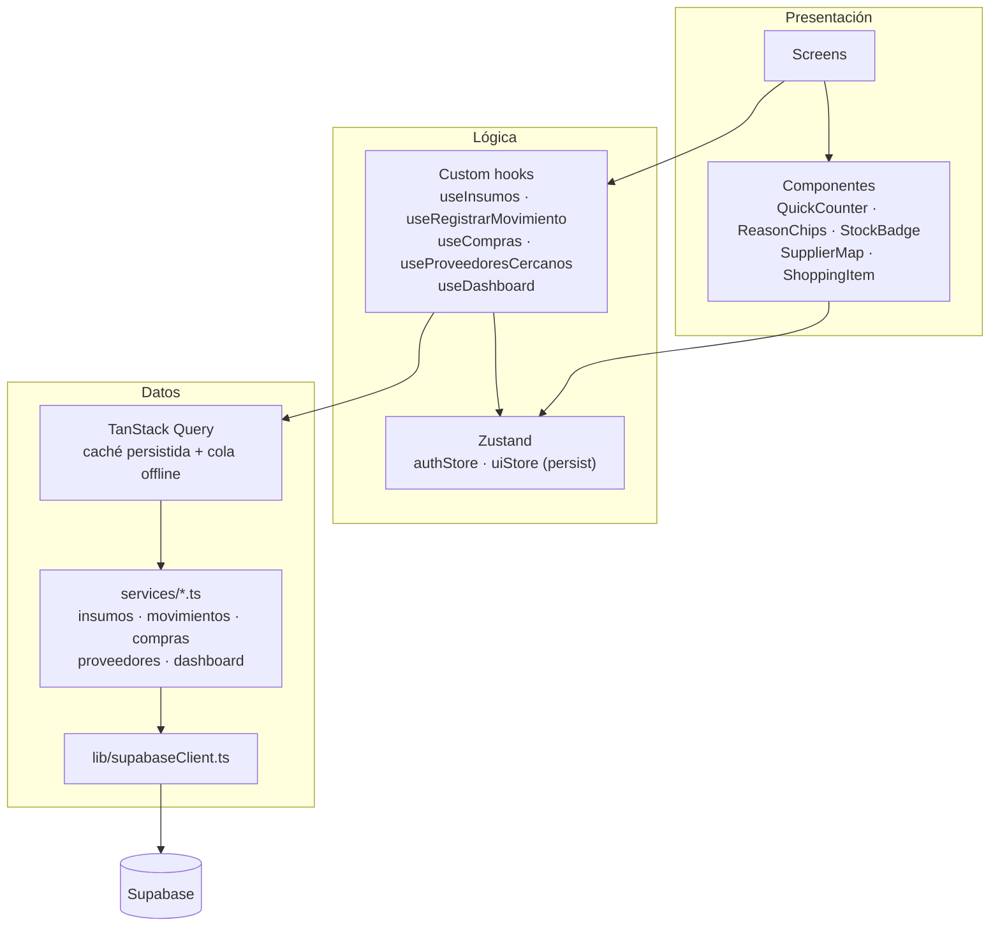

# Fase 2 · Diseño: Arquitectura frontend

> **POSCafé · Specs · Fase 2 · Diseño** · Índice general: `docs/specs/README.md`




**Estructura de carpetas objetivo (Expo Router)**

```
poscafe/
├─ docs/                       # SDD_POSCafé.md, Specs_POSCafe.md, adr/
├─ supabase/
│  ├─ migrations/              # 0001 base (db pull), 0002_endurecimiento, 0003 (propuesta)
│  ├─ functions/notify-low-stock/index.ts
│  ├─ tests/database/rls_y_stock.test.sql
│  ├─ tests/concurrencia.pgbench.sql
│  └─ config.toml
├─ src/
│  ├─ app/                     # ← Expo Router (rutas delgadas que re-exportan features)
│  │  ├─ _layout.tsx           # providers + inicialización de sesión
│  │  ├─ index.tsx             # redirección inicial
│  │  ├─ (auth)/{_layout,login,register}.tsx
│  │  └─ (app)/
│  │     ├─ _layout.tsx        # guard de sesión + modales
│  │     ├─ (tabs)/
│  │     │  ├─ _layout.tsx     # Tabs
│  │     │  ├─ dashboard/{_layout,index,reports}.tsx
│  │     │  ├─ inventario/{_layout,index,[insumoId],form}.tsx
│  │     │  ├─ compras/{_layout,index,proveedor/[proveedorId]}.tsx
│  │     │  └─ perfil/{_layout,index,usuarios}.tsx
│  │     ├─ movimiento-modal.tsx
│  │     ├─ scan-modal.tsx
│  │     └─ confirmar-compra-modal.tsx
│  ├─ components/              # QuickCounter, ReasonChips, StockBadge, InsumoCard, SupplierMap,
│  │                           # ShoppingItem, SoloAdmin, EmptyState, ErrorState, PantallaCarga
│  ├─ features/                # lógica y pantallas por módulo
│  │  ├─ auth/                 # authStore, Login, Register, Perfil
│  │  ├─ dashboard/            # Dashboard, DashboardReports
│  │  ├─ insumos/              # InventarioList, InsumoForm, InsumoDetalle
│  │  ├─ listaCompras/         # ListaCompras, ConfirmarCompra
│  │  └─ proveedores/          # ProveedorDetalle, ProveedorForm (nuevo)
│  ├─ hooks/                   # useDashboard, useInsumos, useRegistrarMovimiento, useCompras,
│  │                           # useProveedoresCercanos
│  ├─ lib/                     # supabaseClient, queryClient, notifications
│  ├─ providers/               # AppProviders (QueryClient persistido)
│  ├─ services/                # dashboard, insumos, movimientos, compras, proveedores, perfiles
│  ├─ store/                   # uiStore (preferencias, incrementos rápidos; persist)
│  ├─ theme/  types/  utils/
├─ app.json · package.json ("main": "expo-router/entry") · tsconfig.json (alias "@/*")
└─ .env (ignorado) · .env.example
```

**Claves de caché (TanStack Query)**

| Clave | Datos | Se invalida con |
|---|---|---|
| `['insumos', filtros]` | Página de inventario | Movimiento, CRUD, realtime |
| `['insumo', id]` | Detalle | Movimiento, edición |
| `['movimientos', insumoId]` | Historial | Movimiento |
| `['compras']` | Lista pendiente | Movimiento, compra, realtime |
| `['dashboard']` | Resumen y consumo | Movimiento |
| `['proveedores-cercanos', lat, lng, insumoId]` | Mapa | Cambio de posición significativo |
