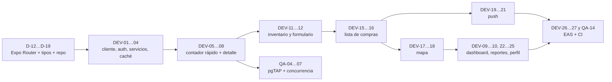

# Ruta de ejecución recomendada

> **POSCafé · Specs · Guía** · Índice general: `docs/specs/README.md`

**Orden sugerido:** (1) resolver ADR-01/03 y estabilizar autenticación; (2) contador rápido de extremo a extremo (es el diferenciador del producto); (3) inventario y formulario; (4) lista de compras; (5) mapa; (6) push; (7) dashboard, reportes y perfil; (8) EAS y CI. Las suites pgTAP (QA-04…07) pueden ejecutarse en paralelo desde el paso 2.
